<p align="center">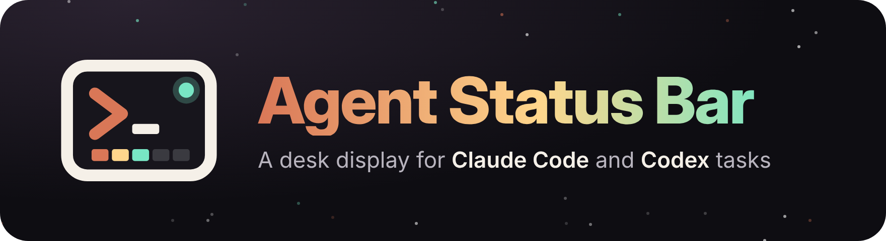</p>

# Agent Status Bar

**English** · [Русский](README.ru.md)

A physical progress display for [Claude Code](https://claude.com/claude-code) and [OpenAI Codex](https://developers.openai.com/codex) tasks, built on an ESP32-S3 with a color screen (LilyGO T-Display-S3, LCD or AMOLED). While the agent works, your desk shows what it is doing, how much of its plan is done, and whether it is waiting for your approval.

<table align="center">
  <tr>
    <th></th>
    <th>Working on a task</th>
    <th>Ready to work</th>
  </tr>
  <tr>
    <td><b>Claude</b></td>
    <td></td>
    <td></td>
  </tr>
  <tr>
    <td><b>Codex</b></td>
    <td></td>
    <td>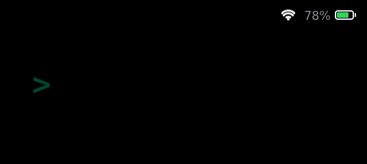</td>
  </tr>
</table>

> **First build?** [Step-by-step setup from scratch](#step-by-step-setup-from-scratch) — from the bare board to statuses on screen, no ESP-IDF needed. Something went wrong — see [Troubleshooting](#troubleshooting).

## What the screen shows

While a task runs you get your prompt, the current step ("Editing auth.ts", "$ npm test"), a segmented progress bar built from the agent's plan (up to 12 items), a "3/7" counter with a percentage, and elapsed time. The status pill and the bar change color with the state:

| State | Claude theme | Codex theme | When |
|---|---|---|---|
| Start | 🔴 Red | ⚪ White | You sent a task, the agent is thinking |
| Working | 🟠 Orange | 🟢 ChatGPT green | The agent is calling tools: editing files, running commands |
| Waiting for you | 🟡 Yellow | 🟡 Amber | The agent asks for permission |
| Done | 🟢 Green | 🟢 Light mint | The task is finished |
| Error | 🩷 Pink-red | 🔴 Red | A tool failed or the task was interrupted (rate limit, server error) |
| Compacting | 🩵 Cyan | 🔵 Blue | The agent is compacting its context |
| Idle | ⚪ Gray | ⚪ Gray | No active task: the idle scene plays |

Animations are made with LVGL: smooth color transitions, segment fills, a pulsing current step (faster while waiting for you) and a left-to-right wave on completion. After 10 idle minutes the mascot falls asleep and the screen dims; after 30 it turns off to protect the AMOLED from burn-in.

### Every screen in both themes

Every GIF here is rendered by the **real firmware UI code** running in the [simulator](#firmware-simulator), not drawn separately — each scenario in both themes. The [Russian README](README.ru.md) shows the same screens in Russian. Regenerate them all with `python tools/sim/render_docs.py`.

<table align="center">
  <tr>
    <th width="50%">Claude</th>
    <th width="50%">Codex</th>
  </tr>
  <tr>
    <td colspan="2"><b>A task from start to finish</b> — Red start while the agent thinks, then work: the step text changes, plan segments fill, the current one pulses. A permission request turns everything yellow; on “Done” the bar fills in a wave, the pill hops and confetti flies.</td>
  </tr>
  <tr>
    <td align="center"></td>
    <td align="center"></td>
  </tr>
  <tr>
    <td colspan="2"><b>Errors</b> — A failed tool shakes the status pill and turns the step red; the next tool call returns to work. A task that stops on a rate limit or a server error stays red with the reason.</td>
  </tr>
  <tr>
    <td align="center">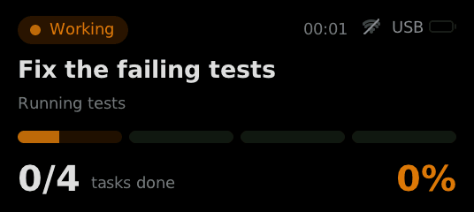</td>
    <td align="center">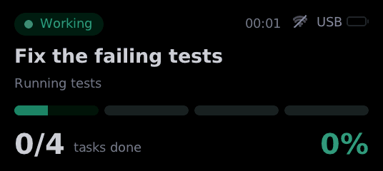</td>
  </tr>
  <tr>
    <td colspan="2"><b>Subagents and compaction</b> — A badge counts running subagents (×3). While the context is compacted, the progress bar squeezes up and down.</td>
  </tr>
  <tr>
    <td align="center">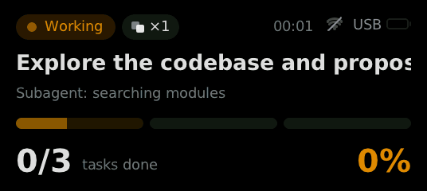</td>
    <td align="center">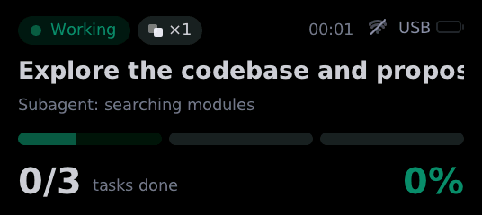</td>
  </tr>
  <tr>
    <td colspan="2"><b>Waiting too long</b> — After a minute without your answer the label shows how long it has waited and the screen edge starts to flash.</td>
  </tr>
  <tr>
    <td align="center">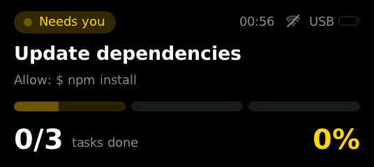</td>
    <td align="center">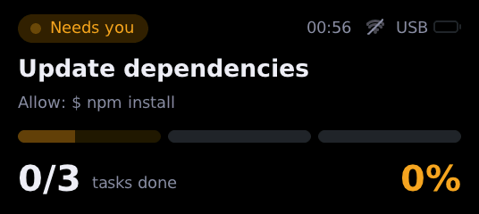</td>
  </tr>
  <tr>
    <td colspan="2"><b>Button: approve, deny, next scene, mute</b> — Hold to allow, tap to deny (Claude Code). When the wait cannot be answered with the button, the board says *Answer on the computer*. The rest of the time a double press switches the idle scene, a long press mutes — the crossed-out speaker stays in the corner.</td>
  </tr>
  <tr>
    <td align="center"></td>
    <td align="center">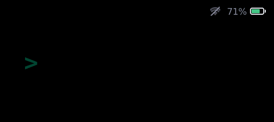</td>
  </tr>
  <tr>
    <td colspan="2"><b>Battery, charging and Wi-Fi</b> — Green above 50%, orange 21–50%, red 20% and below; while charging a bolt appears and the fill sweeps to full. The Wi-Fi fan shows signal strength.</td>
  </tr>
  <tr>
    <td align="center">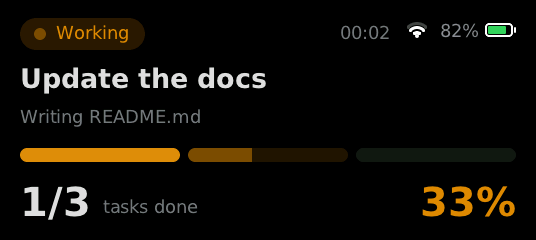</td>
    <td align="center">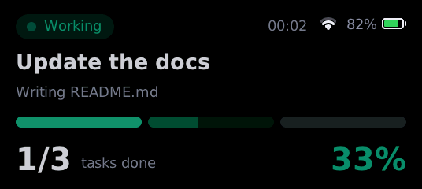</td>
  </tr>
  <tr>
    <td colspan="2"><b>Link lost</b> — The daemon pings every 5 s. After 15 s of silence (laptop asleep, cable out) the screen dims and a banner at the top says so, instead of showing a stale status as if it were current.</td>
  </tr>
  <tr>
    <td align="center">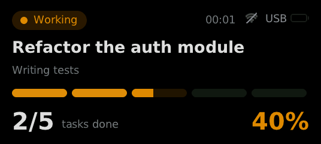</td>
    <td align="center">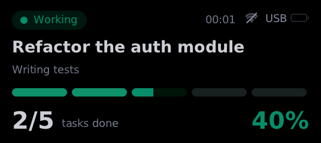</td>
  </tr>
  <tr>
    <td colspan="2"><b>Into work and back</b> — A task arrives: the mascot leaps out of frame and the task screen slides in. After “Done”, or when the session closes, the task screen fades and the idle scene starts over.</td>
  </tr>
  <tr>
    <td align="center">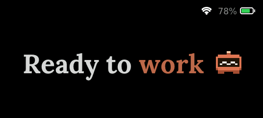</td>
    <td align="center"></td>
  </tr>
  <tr>
    <td colspan="2"><b>Sleep</b> — After 10 minutes without events the mascot dozes off, “z z z” float up and the screen dims. After 30 minutes the screen turns off so the AMOLED does not burn in. Any event wakes it.</td>
  </tr>
  <tr>
    <td align="center">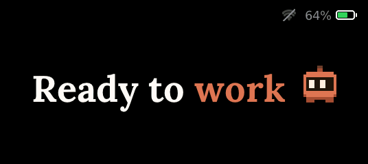</td>
    <td align="center">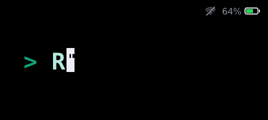</td>
  </tr>
  <tr>
    <td colspan="2"><b>Pairing screen</b> — When a computer pairs with the board over Wi-Fi, the same six-digit code is shown in its console and on the board — like Bluetooth pairing. Press the button to confirm, hold it to cancel. See <a href="#wi-fi">Wi-Fi</a>.</td>
  </tr>
  <tr>
    <td align="center">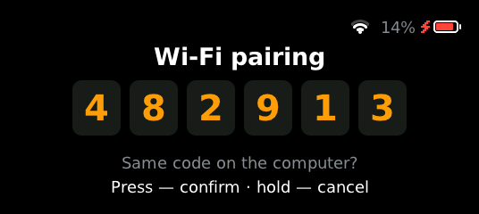</td>
    <td align="center">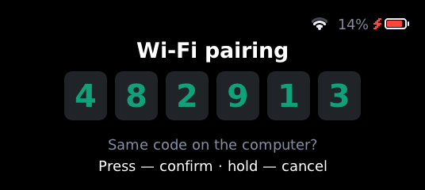</td>
  </tr>
  <tr>
    <td align="center" valign="top">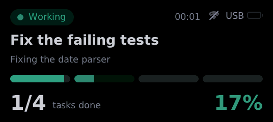<br><b>Several sessions</b><br>Codex works in one terminal, Claude asks for permission in another: the screen shows whatever needs you, the rest is a “+1 session” badge and the theme follows the session on screen.</td>
    <td align="center" valign="top"><br><b>Boot splash</b><br>The logo draws itself in the middle — the prompt, the progress segments, the "live" dot — then flies next to the name; a starry sky, the mascots take turns hopping and sending hearts, the name shimmers, and the bottom shows the Wi-Fi status and a loading bar. It waits up to 15 seconds for Wi-Fi and leaves as soon as the network is up; press the button to skip.</td>
  </tr>
</table>

### Themes

The screen follows whichever agent sent the latest event.

- **Claude** — warm orange accents, Lora serif for the idle scenes, DejaVu Sans for the task screen.
- **Codex** — black, white and ChatGPT green `#10A37F`, monospace type in the idle scenes like a terminal.

> The firmware switches colors, mascots and idle scenes per theme. A monospace font for the Codex task screen is planned; for now both task screens use DejaVu Sans.

Mascots are original pixel characters made for this project; no logos or brand characters are used.

### Idle scenes — pick one

Each theme has two idle scenes. Every scene ends with the mascot leaping at the camera and melting into the theme color, then loops seamlessly. These GIFs are recorded from the firmware in the simulator.

<table align="center">
  <tr>
    <td align="center"><br><b>Claude · <code>robot</code></b> (default)<br>A pixel robot drops onto the text and hops letter by letter; each letter dips under it and lights up.</td>
    <td align="center">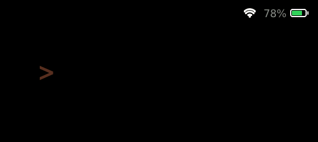<br><b>Claude · <code>cursor</code></b><br>An orange cursor wakes up, opens its eyes and types the line, leaving letters behind as it hops.</td>
  </tr>
  <tr>
    <td align="center"><br><b>Codex · <code>cursor</code></b> (default)<br>The terminal cursor comes alive and types the command; when it blinks, its eyes stay hanging in the air.</td>
    <td align="center">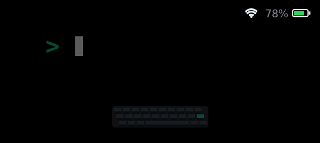<br><b>Codex · <code>typist</code></b><br>A slime sits at a pixel keyboard, taps the keys with two stubby paws and slams Enter.</td>
  </tr>
</table>

Pick a scene per theme in the [settings file](#settings-file) (`idle_claude`, `idle_codex`) or switch it with a double press on the board — the choice is remembered.

### Battery and Wi-Fi

The top-right corner is the same on every screen — boot splash, idle scenes, the task screen and pairing. Battery: green above 50%, orange from 21 to 50%, red at 20% and below; while charging a bolt appears next to it and the fill sweeps to full; without a cell the outline is empty and labeled *USB*. Wi-Fi: a dot and three arcs by signal strength; dim and crossed out while the board is not on Wi-Fi. A crossed-out speaker appears while sound is muted. During the full-screen finale of an idle scene the indicators step aside.

The battery is measured on GPIO4 through the board's 1:2 divider and converted to percent with a Li-ion discharge curve (`firmware/main/platform_esp.c`).

> The screen speaks English or Russian — see [Settings file](#settings-file).

### Button and sound

The board's BOOT button (GPIO0) works without any wiring:

| Press | Does |
|---|---|
| Short | Switches between the idle scene and the last task |
| Double | Next idle scene for the current theme; the choice is sent to the daemon and kept |
| Long (1.2 s) | Mutes or unmutes sounds |
| Any, while the screen sleeps | Wakes it |

**Approve from the board (Claude Code and the claude.ai chat).** On by default while the board is connected: when Claude asks for permission, the screen shows *Hold — allow · tap — deny* with a fill bar. Hold to allow, tap to deny. A question with options (*AskUserQuestion*) shows as *Question → first option*: hold picks that first option, tap skips the question. If nobody presses within `approve_wait` seconds (60 by default), the hook steps aside and Claude Code shows its usual prompt — so for that time the prompt in the terminal appears a little later. In the claude.ai chat the browser extension does the same: when a tool asks for permission, hold the button to press *Allow once* in the chat (never *Always allow*), tap it to press *Deny*; answering in the chat yourself works too and clears the hint on the board. Codex hooks cannot answer permission requests, so there the screen only shows that the agent is waiting, and a press says *Answer on the computer* (instead of muting or switching the scene). If your `config.toml` still has `button_approve = false` (older `config --init` wrote it), turn it on with `python host/daemon.py config set button_approve true`; `false` turns it off. To wait longer or shorter: `config set approve_wait 40`.

A passive buzzer is optional: connect it through a ~100 Ω resistor between a free GPIO (for example 43 or 44) and GND, and set *Buzzer GPIO* in `idf.py menuconfig → Agent Status Bar`. The board then chirps on *waiting*, *done* and *error*, repeats the reminder every minute while you are away, and clicks on button actions. A second button pin can be set in the same menu.

## How it works

```
Claude Code ─┐
             ├─ hook ─▶ hooks/forward.py ─ HTTP ─▶ host/daemon.py ─┬─ USB ─────────────────▶ ESP32-S3
Codex ───────┘                                       │             └─ Wi-Fi (TCP 8766) ───▶ ESP32-S3
                                                     └ adapters/claude.py, codex.py
```

1. Plugin hooks call `hooks/forward.py` on every agent event.
2. The hook forwards the event to a local daemon at `127.0.0.1:8765` and exits immediately, so the agent is never slowed down. If the daemon is not running, the hook starts it.
3. The daemon translates the event into a screen state through an agent-specific adapter and sends one JSON line to the board over USB or, without the cable, over [Wi-Fi](#wi-fi).
4. The firmware knows nothing about agent internals: it draws `state`, `title`, `step`, `done` and `total`, and picks the theme, idle scene and language from `agent`, `idle` and `lang`.

## Hardware

One of two LilyGO boards (ESP32-S3R8, 8 MB PSRAM, 16 MB flash) and a USB-C data cable:

| Board | Screen | How the UI is shown |
|---|---|---|
| [T-Display-S3](https://github.com/Xinyuan-LilyGO/T-Display-S3) | 1.9″ LCD 320×170, ST7789, 8-bit parallel | Scaled down smoothly to 320×143 and centered; same physical size, coarser pixels |
| [T-Display-S3 AMOLED](https://github.com/Xinyuan-LilyGO/T-Display-S3-AMOLED) | 1.91″ AMOLED 536×240, RM67162, QSPI | Pixel for pixel, as in the GIFs above |

The two look almost the same. Tell them apart by the screen: an AMOLED is pitch black where the picture is black, an LCD has a backlight that glows grey. Firmware for the wrong board leaves the screen black (or just backlit).

No soldering required.

### Case

**T-Display-S3 (LCD) + 103565 battery** — in [`hardware/case/lcd/`](hardware/case/lcd/). Three printed parts, 89.2 × 44.1 × 29.3 mm without the cheeks. The board, its buttons and connectors are placed from LilyGO's official 3D model of the T-Display-S3 (`dimensions/t-display-s3-full.stl` in their repository): board 60.8 × 26 × 9.9 mm. The case stands on the desk by itself, the screen at 60° to the desk: the end walls continue into rounded side cheeks with cut-outs, one piece with the shell. The project logo is engraved 0.5 mm deep on the front, and both long walls carry a row of slanted decorative slots, 1 mm deep.

<p align="center">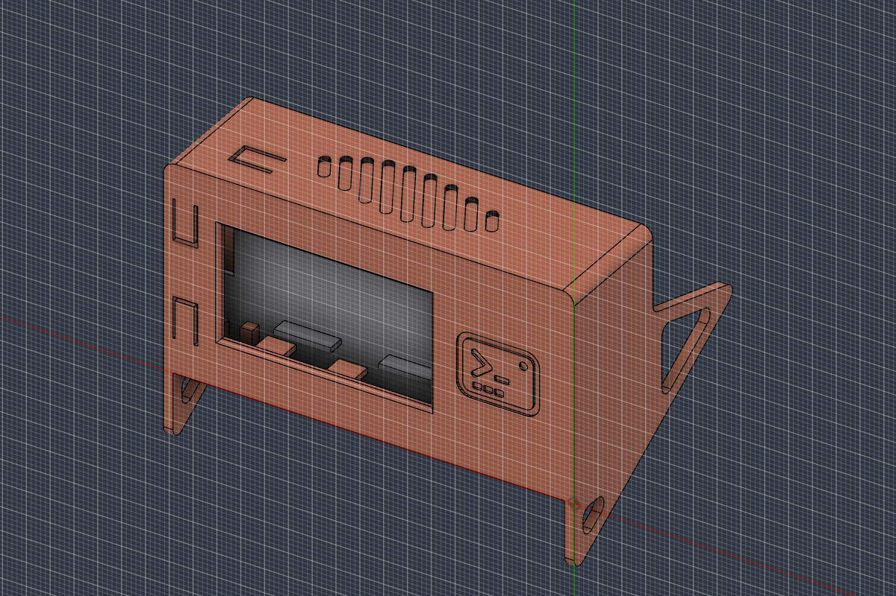 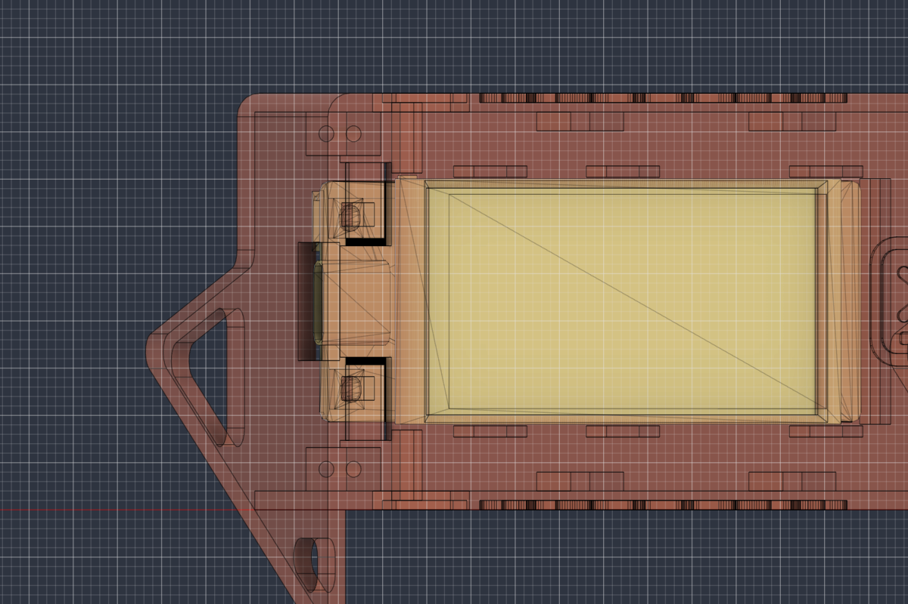</p>

Ready-to-slice STL files (millimetres, every part checked watertight):

| File | Part | Print orientation | Size, mm |
|---|---|---|---|
| [`asb-lcd-shell.stl`](hardware/case/lcd/asb-lcd-shell.stl) | Shell with the cheeks, window, pushers, logo, decorative slots | face (screen side) down | 89.2 × 59.6 × 56.2 |
| [`asb-lcd-divider.stl`](hardware/case/lcd/asb-lcd-divider.stl) | Divider: pads that clamp the board, the bar behind the power switch, battery nest, cable holes, lid standoffs | nest up, with supports under the plate | 84.7 × 39.6 × 24.7 |
| [`asb-lcd-lid.stl`](hardware/case/lcd/asb-lcd-lid.stl) | Back lid with the engraving | engraving up | 84.8 × 39.7 × 2.4 |

PLA or PETG, 0.2 mm layers. The shell and the lid need no supports; the divider has pads and a bar on its underside, so print it with supports (tree supports are easiest to remove).

You also need: eight **M2×8** self-tapping screws (pan head up to Ø4 mm), a 103565 Li-ion cell with a 2-pin 1.25 mm plug (the nest takes up to 68 × 36 × 10.5 mm including the protection board), optionally a **PBS-101G1** (1712-type, 17 × 12 mm) latching power switch.

Assembly:
1. Power switch (if any) into its pocket in the top corner opposite the USB: button through the hole, the lugs through the slots of the end stops.
2. Board glass to the window, USB-C into the end opening, the RST button on the side edge facing the top wall. Side ribs and an end stop hold it with 0.15 mm clearance.
3. Divider on top — its bar comes down behind the power switch and holds it when pressed; — four pads press the edge of the board where its back has no parts, so the board does not move front to back. **Four screws** in the corners go through the divider into the shell's columns.
4. Battery into the nest with the protection board and wires **towards the USB end**: that end of the nest is open, and the wire goes down through the hole right above the battery connector of the board.
5. Lid flush on top — **four screws** into the divider's standoffs. To change the battery, remove only the lid: the board stays clamped.

The buttons are pressed through the case. **BOOT and KEY** sit on the face of the board by the USB-C, one on each side of it; a flexible tongue in the front panel presses the upper one. **RST** is on the side edge of the board, and its tongue is in the top wall — put the board in with the RST button up. The **PBS-101G1** latching power switch (a 1712 «flashlight» switch, body 17 × 12 × 6.5 mm) sits in a pocket in the top wall near the end opposite the USB: Ø6.5 mm hole for the button with a recess for its collar inside, end stops with slots for the lugs, the front panel and the divider on the sides, and a bar coming down from the divider behind it. To fit it, the compartment in front of the divider is 12.6 mm deep, so the case is 2.6 mm thicker. Its size lives in `pwr_*` in `geometry.py`. The divider has a 6 mm U-slot for a wire at the end opposite the USB (open to the edge, so the wire goes in from the side), with a cut in the nest wall above it, so a wire from the power button reaches the battery compartment. The display window is 46.5 mm long.

Changing the case: dimensions live in `geometry.py`; `python hardware/case/lcd/make.py` checks how the board, battery, buttons and screw heads fit and rebuilds the Fusion 360 script (`fusion/AgentStatusBarCase`: Utilities → Scripts and Add-Ins → "+" → Run), which builds the model with full history and saves the STL files next to itself. The fit was checked against LilyGO's model, not a printed part: if your board revision differs, adjust `btn_*`, `rst_*` and `usb_from_glass`.

**T-Display-S3 AMOLED** — below.


[`hardware/case/amoled/`](hardware/case/amoled/) has a three-part 3D-printable case: a tray with room for a small Li-ion cell under the board and openings for USB-C and the side buttons, a screen bezel that snaps in, and a 22° desk stand. The STL files are ready to slice (PLA, 0.2 mm layers, no supports; print the bezel face down). Assembled it is about 65 × 30 × 19 mm.

<p align="center">
  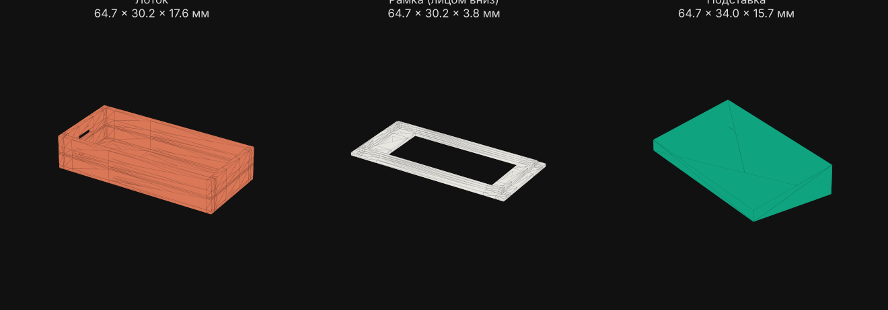
</p>

Dimensions come from the board specs (60 × 25.5 × 10 mm), not from a drawing — measure your board and change `PARAMS` in `hardware/case/amoled/case.py` (or the variables in `case.scad` for OpenSCAD), then run `python hardware/case/amoled/case.py` (needs `numpy` and `matplotlib`) to regenerate the STL. LilyGO also publishes an official case model in the [board repository](https://github.com/Xinyuan-LilyGO/T-Display-S3-AMOLED) (`shell/`).

## Step-by-step setup from scratch

For anyone who has never flashed a board. Everything is on Windows and no ESP-IDF is needed: the project ships ready-made firmware for the LCD board. On macOS and Linux the commands are the same — write `python3` instead of `py -3` and `/` instead of `\` in paths.

**You need:** the board, a USB-C cable **that carries data** (charge-only cables won't show the board), a computer with internet, and [Claude Code](https://claude.com/claude-code) or Codex.

### The easiest way — the setup page

**[yakory777.github.io/Status-Bar](https://yakory777.github.io/Status-Bar/)** — flashing and Wi-Fi right from Chrome or Edge, no console, Python or ESP-IDF. Plug the board in, pick it on the page, press **Flash the board**, then **Connect to the board** and add a network. The page shows the firmware version on the board and offers an update when a new one is out. Steps 2–6 and 9 below do the same from the command line.

<p align="center">
  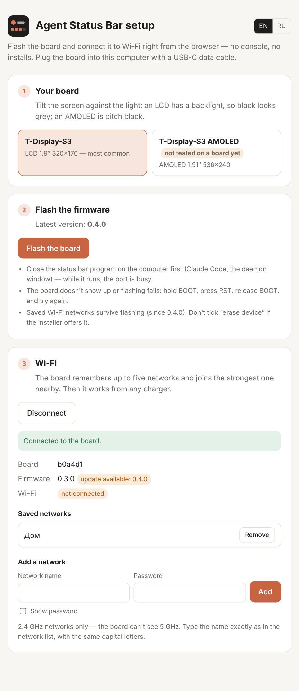
</p>

### Step 1. Identify your board

Look at the screen with the stock firmware, or tilt it against the light: the LCD board (**T-Display-S3**) has a visible backlight — black looks grey. On the **T-Display-S3 AMOLED** black is pitch black, and the board or its box usually says *AMOLED*. Ready-made firmware exists for both; the AMOLED build hasn't been tried on a real board yet.

### Step 2. Install Python

Download Python 3.10 or newer from [python.org](https://www.python.org/downloads/) and install it. Check in a command prompt (`Win+R` → `cmd` → Enter):

```
py -3 --version
```

It should answer `Python 3.x.x`. If the Microsoft Store opens instead, Python is not installed — install it from python.org.

### Step 3. Download the project

On the repository page press the green **Code → Download ZIP** button and unpack it, for example to the desktop. Or, with git: `git clone https://github.com/yakory777/Status-Bar`.

Open a command prompt **right in the project folder**: go there in Explorer (where `README.md`, `host` and `firmware` are), click the address bar at the top, type `cmd` and press Enter. Type every command below in that window.

### Step 4. Install the Python packages

```
py -3 -m pip install pyserial esptool
```

`pyserial` talks to the board over the cable, `esptool` flashes it.

### Step 5. Find the board's COM port

Plug the board in. Open *Device Manager* (right-click Start) → **Ports (COM & LPT)**. You'll see "USB Serial Device (**COM3**)" — the number may differ, note it.

Only COM1, or nothing new? Either the cable has no data lines or the board isn't answering: hold **BOOT** on the board, press **RST** briefly, release BOOT — the port should appear.

### Step 6. Flash

Put your port number instead of `COM3`:

```
py -3 -m esptool --chip esp32s3 -p COM3 -b 460800 write_flash 0x0 firmware\prebuilt\agent-status-bar-tdisplay-s3.bin
```

It takes about a minute and ends with `Hash of data verified`. `Failed to connect` — hold BOOT, press RST, release BOOT and run it again.

After flashing press RST or replug the cable. You'll see the splash — it waits up to 15 seconds for Wi-Fi (6 seconds with no networks saved; press the button to skip) — and then the idle scene with **"No connection to the computer"** at the top — that's expected: nothing on the computer is talking to the board yet.

### Step 7. Test without an agent

```
py -3 host\daemon.py --demo
```

A couple of seconds later the banner disappears and a sample task runs on the screen. Stop it with `Ctrl+C`. If it says the port is busy, close whatever may hold the COM port (ESP-IDF monitor, Arduino IDE, another daemon window).

### Step 8. Connect Claude Code

Statuses come from hooks, which exist in **Claude Code** — in the terminal and in the Code tab of the Claude desktop app — and in Codex. Using the regular claude.ai chat in a browser? Install the [extension](#claudeai-chat-in-the-browser).

In Claude Code enter **one command at a time** (two commands in one input don't work):

```
/plugin marketplace add yakory777/Status-Bar
```

```
/plugin install agent-status-bar@agent-status-bar
```

Restart Claude Code and give it any task — the screen switches to it. No need to start the daemon by hand: the first agent event starts it.

For Codex: `codex plugin marketplace add yakory777/Status-Bar`, then enable **Agent Status Bar** in the plugin list and allow its hooks.

### Step 9 (optional). No cable, over Wi-Fi

With the board on the cable, from the project folder:

```
py -3 host\daemon.py wifi add "NetworkName" "password"
```

The name must match the Wi-Fi list exactly, including capital letters; the network must be **2.4 GHz** (the board can't see 5 GHz networks). The board restarts; after 15 seconds check:

```
py -3 host\daemon.py wifi list
```

It shows the board's IP, and the Wi-Fi icon on the screen is no longer crossed out. Put the IP into the settings so the daemon reaches the board without searching:

```
py -3 host\daemon.py config --init
notepad %USERPROFILE%\.agent-status\config.toml
```

Last line: `wifi_host = "192.168.1.50"` (your IP). Save. Now the board can run from any charger — the daemon finds it on the network and returns to the cable when you plug it in. This computer needs no pairing: the board already knows it from the cable. More in [Wi-Fi](#wi-fi).

## Installation

The short version, for those who know ESP-IDF. New to this? Follow the [steps above](#step-by-step-setup-from-scratch).

### 1. Flash the board

Ready-made firmware is in [`firmware/prebuilt/`](firmware/prebuilt/) (`…-tdisplay-s3.bin` — LCD, `…-amoled.bin` — AMOLED) — no ESP-IDF needed. Easiest is the [setup page](https://yakory777.github.io/Status-Bar/), or:

```bash
python -m esptool --chip esp32s3 -p COM3 -b 460800 write_flash 0x0 firmware/prebuilt/agent-status-bar-tdisplay-s3.bin
```

To build it yourself:

You need [ESP-IDF](https://docs.espressif.com/projects/esp-idf/) 5.1 or newer (on Windows, use the *ESP-IDF CMD* shortcut it installs). LVGL 9.2 is fetched automatically by the component manager.

```bash
cd firmware
idf.py set-target esp32s3
idf.py menuconfig          # Agent Status Bar → Board: T-Display-S3 (LCD, default) or T-Display-S3 AMOLED
idf.py build flash monitor # monitor shows the board's log; quit with Ctrl+]
```

If flashing fails, hold BOOT, press RST, release BOOT. After flashing, unplug and replug the cable.

Black screen? Turn on *Flash red, green and blue at boot* in the same menu: the panel is then tested before the UI starts, and no colours means the wrong board is selected. Upside down? Turn on *Rotate the picture 180 degrees*. `idf.py monitor` prints the frame rate every 5 s (`perf: … fps`).

### 2. Install the Python dependency

```bash
pip install pyserial          # on Windows: py -3 -m pip install pyserial
```

### 3. Install the plugin

**Claude Code**

```
/plugin marketplace add yakory777/Status-Bar
/plugin install agent-status-bar@agent-status-bar
```

**Codex**

```bash
codex plugin marketplace add yakory777/Status-Bar
```

Then install **Agent Status Bar** from the plugin list. Codex does not trust plugin hooks automatically: review and enable them when Codex asks.

That's it. The first agent event starts the daemon, which finds the board by its Espressif USB VID (or uses `serial_port` from the [settings file](#settings-file)).

The hooks try `python3`, then `python`, then the `py -3` launcher, so a standard Windows install of Python works as is. On Windows, install pyserial for that same Python: `py -3 -m pip install pyserial`. If `python` opens the Microsoft Store, turn off the *python.exe* and *python3.exe* app execution aliases in Settings.

## Wi-Fi

The board works over the USB cable out of the box. To put it anywhere on your desk with just a charger, teach it your networks — it remembers up to five and joins the strongest one in range.

**1. Add networks** (board connected with the cable, from the project folder):

```bash
python host/daemon.py wifi add "Home" "password"
python host/daemon.py wifi add "Office" "password"
python host/daemon.py wifi list            # saved networks, current one, IP and signal
python host/daemon.py wifi remove "Office"
```

Networks are kept in the board's memory and survive restarts and reflashing. The board sees **2.4 GHz** networks only; type the name exactly as in the network list, same capitalization. The board restarts after each change and connects within a few seconds; the Wi-Fi icon in the corner shows the signal. Adding networks over the cable also makes the board trust this computer, so no pairing is needed for it.

**2. Unplug the data cable.** Power the board from a charger or its battery. The daemon finds it on the network by itself (the computer must be on the same network) and switches back to the cable whenever you plug it in again. After the board, the router or the computer restarts, the link comes back on its own: the daemon remembers the board's last IP and, if the router handed out a new one, tries every address of its network. It notices a vanished board within about 25 seconds and starts looking for it again.

**Another computer** that never saw the board over USB pairs over the network:

```bash
python host/daemon.py pair
```

A computer the board already knows gets no code — `pair` just says it is paired. For a new computer a six-digit code appears in the console and on the board. Same code — press the board's button; hold it to cancel. The board then accepts status updates only from computers it trusts, so a colleague's agent on the office network will not show up on your screen.

`python host/daemon.py boards` lists the boards on the network. If none is found although the board is connected (the broadcast went into a VPN or WSL adapter, or the router or firewall drops it), give its IP from `wifi list`: `python host/daemon.py pair --ip 192.168.1.50` — and put it into `wifi_host` in the [settings file](#settings-file) so the daemon always goes straight to it. `transport = "usb"` or `"wifi"` there forces one way.

<p align="center">
  
</p>

## claude.ai chat in the browser

The regular claude.ai chat has no hooks, so a Chrome extension in [`browser/`](browser/) passes its status on. It works in other Chromium browsers too — Edge, Yandex Browser, Opera. Firefox and Safari are not supported, and neither is the Chat tab of the Claude desktop app, which takes no extensions.

The extension watches the page and shows it on the board with the Claude theme:

| On the page | On the board |
|---|---|
| You sent a question | "Thinking…", title — your question |
| Claude is writing the answer | "Writing the answer", title — the chat name |
| An "Allow" prompt for a tool | Waiting for you; hold the button — *Allow once*, tap — *Deny* |
| The answer is ready | Done · "Answer ready" |
| The tab was closed | Idle scene |

Every tab is a separate session, so the chat and Claude Code share the screen: the most important task is shown, the rest as a "+N" badge. The chat has no plan, so the progress bar simply fills when the answer is ready.

**Install**

1. Open `chrome://extensions`, turn on **Developer mode** (top right), press **Load unpacked** and pick the project's `browser` folder.
2. Reload open claude.ai tabs (F5).
3. Start the daemon. The chat has no hooks to start it, so on Windows turn on autostart: double-click `tools\windows\autostart.cmd`. The daemon starts right away and then with every Windows sign-in, without a window. To turn it off: `tools\windows\autostart.cmd remove`. By hand: `py -3 host\daemon.py`; on macOS and Linux `python3 host/daemon.py`.
4. Click the extension icon. The popup shows whether the program on the computer is running, how the board is connected, what the page looks like and which signals fired. You can switch the extension off there too, and the **Flash the board · set up Wi-Fi** button opens the [setup page](https://yakory777.github.io/Status-Bar/).

<p align="center">
  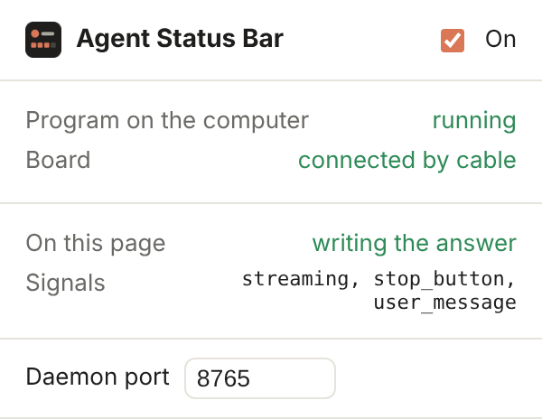
</p>

**If the status stops being detected.** claude.ai changes its markup from time to time. Everything the extension knows about the page is in [`browser/detect.js`](browser/detect.js). While Claude is writing, the popup's *Signals* line should show `streaming` or `stop_button`. If it's empty, the signals are out of date: open an issue, and after editing `detect.js` press ⟳ on the extension in `chrome://extensions`.

## Troubleshooting

Everything we have already run into, with causes and fixes.

**Flashing**

| What you see | Why | What to do |
|---|---|---|
| `'esptool.py' is not recognized as an internal or external command` | Newer versions drop the `.py` | `esptool …` in the ESP-IDF window or `py -3 -m esptool …` in a normal one |
| `The system cannot find the path specified`, `CMakeLists.txt not found` | The command runs in the wrong folder | `idf.py` only from `firmware`, `py -3 host\daemon.py` from the project root. Quote paths with spaces |
| Only COM1 in Device Manager, `Failed to connect` | Charge-only cable, or the board isn't in download mode | Another cable or USB port; hold BOOT, press RST, release BOOT |
| `could not open port 'COM3'`, `Access is denied`, port busy | Another program holds the port — usually a running daemon or `idf.py monitor` | Close Claude Code and the monitor. Still busy — in PowerShell: `Get-CimInstance Win32_Process -Filter "Name like 'py%'" \| ? CommandLine -like '*daemon.py*' \| % { Stop-Process -Id $_.ProcessId }` |
| After flashing the screen is black, flickers or only the backlight glows | Firmware for the other board (AMOLED firmware on the LCD board or vice versa) | LCD — `firmware\prebuilt\agent-status-bar-tdisplay-s3.bin` or *Board: T-Display-S3* in menuconfig; AMOLED — *T-Display-S3 AMOLED*. Panel test — *Flash red, green and blue at boot* |
| Picture upside down | The board is mounted the other way | menuconfig → *Rotate the picture 180 degrees* |
| After flashing, `wifi list` says `Saved networks: none` | Firmware before 0.4.0 kept networks where the ready-made image writes; the setup page before 1.0.0 wiped the whole board without asking | Flash the current one and add the networks once more. On the setup page the installer asks “Erase device” — leave it unticked and the networks stay |
| Animation slow and choppy | Old firmware | Flash the current one. `idf.py -p COM3 monitor` prints `perf: … fps` every 5 s — attach that line to an issue |

**Computer and Claude Code**

| What you see | Why | What to do |
|---|---|---|
| `python` opens the Microsoft Store, hooks do nothing | On Windows `python` and `python3` are Store stubs | Install Python from python.org and use `py -3`; the hooks try `py -3` themselves. Optionally turn off the *python.exe* and *python3.exe* app execution aliases in Settings |
| `No module named serial` | pyserial went into another Python | `py -3 -m pip install pyserial` |
| `Path does not exist: …\Status-Bar \plugin install …` | Both `/plugin` commands pasted into one input | Enter them one by one |
| "No connection to the computer" on the board | The daemon isn't running (Claude Code closed or no events yet) | Give the agent a task or run `py -3 host\daemon.py` |
| Nothing arrives from the claude.ai chat | The browser chat has no hooks | Install the [extension](#claudeai-chat-in-the-browser) and start the daemon (`tools\windows\autostart.cmd`). The popup shows what is wrong |

**Wi-Fi**

| What you see | Why | What to do |
|---|---|---|
| `wifi list` → `Saved networks: none` | No networks added yet | `py -3 host\daemon.py wifi add "NetworkName" "password"` |
| Network saved but never connects | 5 GHz network, typo in the name or password | Pick the 2.4 GHz network (no *5G* in the name); same capitalization; `wifi remove` and add again |
| `No board found on the network` | The broadcast went out the wrong adapter (VPN, WSL, Hyper-V), or the router or firewall drops it | Give the IP from `wifi list`: `py -3 host\daemon.py pair --ip 192.168.1.50` and put it into `wifi_host`. When Windows asks about network access for Python, allow it |
| Wi-Fi doesn't come back after the board or router restarts | Old daemon: the board got a new IP and the daemon kept knocking on the old one | Update the project — the new daemon finds the board at its new IP too. If the Wi-Fi icon on the board is crossed out, the board itself isn't on the network: check `wifi list` over the cable |
| The pairing code never appears on the board | This computer has used the cable before and the board trusts it — no pairing needed | Nothing to do: `pair` says so. Only another computer needs the code |
| Pairing drops by itself | The background daemon reconnects and pushes the pairing out (the board keeps one network connection) | Close Claude Code and the daemon first, then `pair` |

To test pairing on the same computer, introduce it to the board as a new one — in a separate `cmd` window, with the daemon stopped:

```
set AGENT_STATUS_HOME=%TEMP%\asb-test
py -3 host\daemon.py pair --ip 192.168.1.50
```

`set` lasts only for that window; close it afterwards — your settings stay as they were.

Not listed? Open an issue with the error text, the output of `wifi list` and the last lines of `idf.py -p COM3 monitor`.

## Try it without a board

### Firmware simulator

`tools/sim/` builds the firmware's own UI code (`firmware/main/ui_*.c`, `protocol.c`) with LVGL 9.2 on your computer, plays a scenario and saves a GIF. No board, no ESP-IDF:

```bash
pip install pillow                     # plus cmake and a C compiler
python tools/sim/render.py tools/sim/scenarios/error.txt error.gif
python tools/sim/render.py tools/sim/scenarios/wait_escalation.txt wait.gif --clip 57-68
```

A scenario is a text file of `<time_ms> <JSON line>`, exactly what the daemon sends to the board. CI runs every scenario in `tools/sim/scenarios/`, so a change that breaks the screen code fails the build.

### Browser emulator

Open [`docs/emulator.html`](docs/emulator.html) in a browser for a quick interactive preview: the buttons simulate hook events. It is an older JavaScript copy of the task screen and lacks the newer screens (idle scenes, indicators, button, languages); the simulator above is the accurate one.

You can also run the daemon in demo mode or poke it with curl:

```bash
python host/daemon.py --demo
curl -X POST "http://127.0.0.1:8765/?agent=claude" -d '{"hook_event_name":"UserPromptSubmit","prompt":"Test"}'
curl -X POST "http://127.0.0.1:8765/?agent=claude" -d '{"hook_event_name":"Stop"}'
curl http://127.0.0.1:8765/   # current state
```

## Protocol

The daemon sends one JSON line per update:

```json
{"state":"work","title":"Refactor the auth module","step":"Writing tests","done":3,"total":5,"sub":2,"others":1,"agent":"claude","idle":"robot","lang":"en"}
{"ping":1}
```

| Field | Meaning |
|---|---|
| `state` | `idle`, `start`, `work`, `wait`, `done`, `error`, `compact` |
| `title`, `step` | Prompt and current step; omit to keep the previous text |
| `done`, `total` | Plan progress, `total` is clamped to 1–12 |
| `sub` | Running subagents (badge hidden at 0) |
| `others` | Other active sessions (badge hidden at 0) |
| `agent` | Theme: `claude` or `codex` |
| `idle` | Idle scene for the theme |
| `ping` | Keep-alive, sent every 5 s; 15 s of silence shows “link lost” |
| `pair` | Six-digit code to show on the pairing screen; `""` hides it. Over Wi-Fi it comes with `pair_token` — see [`net_esp.h`](firmware/main/net_esp.h) for `hello`, `pair`, `wifi_add`/`wifi_remove`/`wifi_list` |
| `approve` | `true` — the board offers hold-to-allow / tap-to-deny for the current wait |
| `lang` | `en` or `ru` — language of the board's own labels |

The board sends lines back on button actions: `{"button":"approve"}`, `{"button":"deny"}`, `{"button":"scene_next","scene":"cursor"}`.

Every field is optional; the board remembers the last value. Anything that can write to a serial port can drive the display, not just coding agents.

### Events the daemon listens to

| Screen | Claude Code | Codex | claude.ai chat (extension) |
|---|---|---|---|
| Start | `UserPromptSubmit` | `UserPromptSubmit` | `WebPrompt` |
| Work, current step | `PreToolUse`, `PostToolUse` | `PreToolUse`, `PostToolUse` | `WebBusy` (thinking / writing) |
| Plan progress | `TaskCreated`, `TaskCompleted` events; `TaskCreate`, `TaskUpdate`, legacy `TodoWrite` tools | `update_plan` tool | — |
| Waiting for you | `PermissionRequest`, `Notification` (permission and input prompts) | `PermissionRequest` | `WebWait` |
| Error | `PostToolUseFailure`, `StopFailure` | non-zero exit code in `PostToolUse` | `WebError` |
| Subagents | `SubagentStart`, `SubagentStop` | `SubagentStart`, `SubagentStop` | — |
| Compacting | `PreCompact`, `PostCompact` | `PreCompact`, `PostCompact` | — |
| Done | `Stop` | `Stop` | `WebDone` |
| Session closed | `SessionEnd` | — | `SessionEnd` (tab closed) |

## Adding another agent

Create `host/adapters/<name>.py` with a `NAME` string and a `handle(event, state, ctx)` function that updates `state` and returns `True` when the screen should be redrawn, register it in `host/adapters/__init__.py`, and point the agent's hooks at `hooks/forward.py <name>`.

## Configuration

### Settings file

The daemon and the hooks read `~/.agent-status/config.toml`. Create it with comments and see what is in effect:

```bash
python host/daemon.py config --init   # creates ~/.agent-status/config.toml
python host/daemon.py config          # prints the effective settings and where each comes from
python host/daemon.py config set button_approve true   # changes one setting in the file
```

```toml
language = "auto"        # screen language: "en", "ru" or "auto" (from the system locale)
serial_port = ""         # empty — find the board by USB; or "COM5", "/dev/cu.usbmodem1101"
http_port = 8765
autostart = true         # the hook starts the daemon when it is not running
idle_claude = "robot"    # robot | cursor
idle_codex = "cursor"    # cursor | typist
button_approve = true    # answer Claude Code permission requests with the button
approve_wait = 60        # seconds the hook waits for the button (1–120)
transport = "auto"       # auto (cable, otherwise Wi-Fi) | usb | wifi
wifi_host = ""           # the board's IP, only if it is not found on the network by itself
```

Every key has an environment variable that wins over the file: `AGENT_STATUS_LANG`, `AGENT_STATUS_SERIAL`, `AGENT_STATUS_PORT`, `AGENT_STATUS_AUTOSTART`, `AGENT_STATUS_IDLE_CLAUDE`, `AGENT_STATUS_IDLE_CODEX`, `AGENT_STATUS_BUTTON_APPROVE`, `AGENT_STATUS_APPROVE_WAIT`, `AGENT_STATUS_TRANSPORT`, `AGENT_STATUS_WIFI_HOST`. The folder can be moved with `AGENT_STATUS_HOME`, the file alone with `AGENT_STATUS_CONFIG`.

The idle scene picked with a double press on the board is saved next to it in `state.json` and survives restarts.

**Language.** The daemon sends `"lang"` with every update, so the board's own labels (“Working”, “Needs you”) and the texts the daemon writes (“Editing auth.ts”, “Allow writing README.md?”) switch together. Until the first message the board uses the language from `idf.py menuconfig → Agent Status Bar → Screen language`. Translations live in `host/i18n.py` and `firmware/main/ui_i18n.c`; adding a language means one more column in each.

### Firmware constants

| What | Where |
|---|---|
| State colors per theme | `THEMES` in `firmware/main/ui_status.c` |
| On-screen labels | `TEXT` in `firmware/main/ui_i18n.c` |
| When waiting starts to nag | `UI_WAIT_ESCALATE_MS` in `firmware/main/ui_status.h` (60 s) |
| Link-lost timeout | `PROTO_LINK_TIMEOUT_MS` in `firmware/main/protocol.h` (15 s) |
| How long “Done” stays before the idle scene | `UI_DONE_TO_IDLE_MS` in `firmware/main/ui_screen.h` (90 s) |
| Mascot falls asleep, screen dims | `UI_SLEEP_AFTER_MS`, `UI_BRIGHT_SLEEP` in the same file (10 min) |
| Screen turns off | `UI_OFF_AFTER_MS` in the same file (30 min) |
| Battery pin and thresholds | `BAT_ADC_CHANNEL`, `BAT_NO_BATTERY_MV`, `BAT_USB_MV` in `firmware/main/platform_esp.c` |
| Normal brightness | `UI_BRIGHT_ON` in `firmware/main/ui_screen.h` |
| Upside-down image | `idf.py menuconfig → Agent Status Bar → Rotate the picture 180 degrees`; mirrored on AMOLED — `LCD_MADCTL` in `firmware/main/display_rm67162.c` |
| Stripes or artifacts | AMOLED: `LCD_FREQ` in `firmware/main/display_rm67162.c` (40 MHz; 75 MHz is faster if stable). LCD: `PCLK_HZ` in `firmware/main/display_st7789.c` (10 MHz) |
| Font | replace the TTF files in `firmware/main/fonts/` (keep the names) |
| Button, second button, buzzer pins, default language | `idf.py menuconfig → Agent Status Bar` |
| Long-press and double-press timing | `UI_LONG_PRESS_MS`, `UI_DOUBLE_CLICK_MS` in `firmware/main/ui_input.h` |

## Regenerating the previews

Firmware GIFs (everything in `docs/firmware/`, both themes and both languages) come from the simulator; `ffmpeg`, if installed, makes them about half the size:

```bash
pip install pillow                                # plus cmake and a C compiler
python tools/sim/render_docs.py                   # all of them, ~1 min
python tools/sim/render_docs.py --lang en         # one language
python tools/sim/render_docs.py task button       # just these
```

The original design previews in Python (only the first two are kept in `docs/`):

```bash
python tools/render_task.py --theme claude        # docs/claude_task.gif
python tools/render_task.py --theme codex         # docs/codex_task.gif
python tools/render_idle_robot.py                 # docs/claude_idle_robot.gif
python tools/render_idle_cursor.py --theme claude # docs/claude_idle_cursor.gif
python tools/render_idle_cursor.py --theme codex  # docs/codex_idle_cursor.gif
python tools/render_idle_typist.py                # docs/codex_idle_typist.gif
```

Fonts used by the renderers live in `tools/fonts/` with their licenses (Lora — SIL OFL 1.1, DejaVu — Bitstream Vera license).

## Project layout

```
.claude-plugin/        Claude Code plugin and marketplace manifests
.codex-plugin/         Codex plugin manifest
.agents/plugins/       Codex marketplace manifest
hooks/                 hook definitions and forward.py
browser/               Chrome extension for the claude.ai chat: detect.js (page signals), content.js, background.js, popup
host/                  daemon.py, sessions.py (several sessions at once), links.py (USB and Wi-Fi), config.py (settings), i18n.py (texts), per-agent adapters
firmware/prebuilt/     ready-made firmware for the T-Display-S3 (LCD) and AMOLED, flashed from the setup page or with one esptool command
docs/flasher/          the setup page (GitHub Pages): flashing via ESP Web Tools and Wi-Fi via Web Serial
firmware/main/         ESP-IDF project, LVGL 9:
  ui_status.c            task screen, themes, scenario states
  ui_scene_*.c           idle scenes (robot, cursor, typist), ui_scene.c runs them
  ui_screen.c            splash, transitions, confetti, sleep, pairing
  ui_icons.c             battery, Wi-Fi and mute indicators
  protocol.c             JSON lines from the host (shared with the simulator)
  ui_input.c, ui_sound.c button actions and melodies
  ui_i18n.c              on-screen labels in English and Russian
  net_esp.c              Wi-Fi: saved networks, discovery, TCP link, trusted computers, pairing
  platform_esp.c         brightness, battery ADC, buzzer; input_esp.c — buttons; display_st7789.c, display_rm67162.c — panel drivers (LCD, AMOLED), display_scale.c — scaling for the LCD
hardware/case/lcd/     LCD + 103565 case: geometry.py, make.py, Fusion 360 script, STL
hardware/case/amoled/  AMOLED case: case.py (generator), case.scad, STL, preview
docs/firmware/         firmware GIFs: en/ and ru/, each with claude/ and codex/; browser emulator in docs/
tools/                 renderers for the design previews
tools/windows/         autostart.cmd — start the daemon at Windows sign-in (for the extension)
tools/sim/             firmware simulator: real UI code + LVGL on a PC, scenarios, GIF export
```

## Status

The daemon, adapters, session handling, idle-scene selection, settings, both languages and the Wi-Fi link (against a fake board) are covered by tests. Every screen, scene and animation runs in the firmware simulator and in CI.

Tested on a real **T-Display-S3 (LCD)**: the screen, animations, the USB link, joining Wi-Fi, finding the board on the network and running without the cable. The **AMOLED** driver follows the RM67162 pinout and protocol from the LilyGO and ESPHome examples but has not yet been run on real hardware, so the first build may need the tweaks from the [firmware constants](#firmware-constants) table. The claude.ai extension is tested against a mock page with the same signals but not yet on the live claude.ai — if the status isn't detected, see [what to do](#claudeai-chat-in-the-browser). The Codex adapter assumes the `update_plan` tool format; if your Codex version differs, adjust `_plan_steps()` in `host/adapters/codex.py`.

Issues with error output or a photo of the screen are very welcome.

## License

[MIT](LICENSE)
