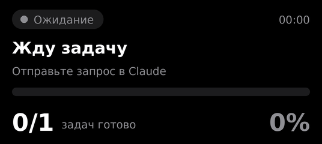
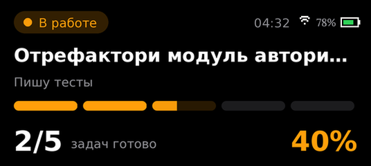

# Agent Status Bar

**English** · [Русский](README.ru.md)

A physical progress display for [Claude Code](https://claude.com/claude-code) and [OpenAI Codex](https://developers.openai.com/codex) tasks, built on an ESP32-S3 with an AMOLED screen. While the agent works, your desk shows what it is doing, how much of its plan is done, and whether it is waiting for your approval.

<table align="center">
  <tr>
    <td align="center"></td>
    <td align="center"></td>
  </tr>
  <tr>
    <td align="center">Working on a task</td>
    <td align="center">Ready to work</td>
  </tr>
</table>

## What the screen shows

| Color | State | When |
|---|---|---|
| 🔴 Red | Start | You sent a task, the agent is thinking |
| 🟠 Orange | Working | The agent is calling tools: editing files, running commands |
| 🟡 Yellow | Waiting for you | The agent asks for permission |
| 🟢 Green | Done | The task is finished |
| ⚪ Gray | Idle | No active task |

Along with the color you get your prompt, the current step ("Editing auth.ts", "$ npm test"), a segmented progress bar built from the agent's plan (up to 12 items), a "3/7" counter with a percentage, and elapsed time.

Animations are made with LVGL: smooth color transitions, segment fills, a pulsing current step (faster while waiting for you) and a left-to-right wave on completion. After 3 idle minutes the screen dims to protect the AMOLED from burn-in.

### Idle screen

When there is no task, a small orange pixel robot takes the stage. It drops onto the first letter of *Ready to work* and hops across the words; every letter dips under its weight and lights up. It jumps down next to the text, breathes, blinks and looks around, then leaps at the camera, melts into solid orange and the scene starts over.

### Wi-Fi and battery

For a battery-powered, wireless build the top-right corner shows Wi-Fi signal (a pixel fan that scans while connecting) and battery charge: green above 50%, orange from 21 to 50%, red at 20% and below.

<p align="center">
  
</p>

> The idle animation and the indicators are design previews for now: [`tools/render_idle_gif.py`](tools/render_idle_gif.py) is the reference for timings and the sprite, and porting them to the firmware is the next step.

> The on-screen labels are in Russian for now. They live in `state_text()` in `firmware/main/ui_status.c` and in `host/adapters/common.py`.

## How it works

```
Claude Code ─┐
             ├─ hook ─▶ hooks/forward.py ─ HTTP ─▶ host/daemon.py ─ USB ─▶ ESP32-S3
Codex ───────┘                                      └ adapters/claude.py, codex.py
```

1. Plugin hooks call `hooks/forward.py` on every agent event.
2. The hook forwards the event to a local daemon at `127.0.0.1:8765` and exits immediately, so the agent is never slowed down. If the daemon is not running, the hook starts it.
3. The daemon translates the event into a screen state through an agent-specific adapter and sends one JSON line to the board over USB.
4. The firmware knows nothing about agents: it only draws `state`, `title`, `step`, `done` and `total`.

## Hardware

- [LilyGO T-Display-S3 AMOLED](https://github.com/Xinyuan-LilyGO/T-Display-S3-AMOLED): ESP32-S3R8, 8 MB PSRAM, 1.91″ 536×240 AMOLED (RM67162 over QSPI).
- A USB-C data cable.

No soldering required.

## Installation

### 1. Flash the board

You need [ESP-IDF](https://docs.espressif.com/projects/esp-idf/) 5.1 or newer. LVGL 9.2 is fetched automatically by the component manager.

```bash
cd firmware
idf.py set-target esp32s3
idf.py build flash
```

If flashing fails, hold BOOT, press RST, release BOOT.

### 2. Install the Python dependency

```bash
pip install pyserial
```

### 3. Install the plugin

**Claude Code**

```
/plugin marketplace add YOUR_GITHUB_USERNAME/agent-status-bar
/plugin install agent-status-bar@agent-status-bar
```

**Codex**

```bash
codex plugin marketplace add YOUR_GITHUB_USERNAME/agent-status-bar
```

Then install **Agent Status Bar** from the plugin list. Codex does not trust plugin hooks automatically: review and enable them when Codex asks.

That's it. The first agent event starts the daemon, which finds the board by its Espressif USB VID.

On Windows the hook command is `python3`. If your Python is only available as `python`, edit the commands in `hooks/hooks.json` and `hooks/codex-hooks.json`.

## Try it without a board

Open [`docs/emulator.html`](docs/emulator.html) in a browser. It reproduces the interface in JavaScript with the same colors, sizes and timings; the buttons simulate hook events.

You can also run the daemon in demo mode or poke it with curl:

```bash
python host/daemon.py --demo
curl -X POST "http://127.0.0.1:8765/?agent=claude" -d '{"hook_event_name":"UserPromptSubmit","prompt":"Test"}'
curl -X POST "http://127.0.0.1:8765/?agent=claude" -d '{"hook_event_name":"Stop"}'
curl http://127.0.0.1:8765/   # current state
```

## Protocol

The daemon sends one JSON line per update:

```json
{"state":"work","title":"Refactor the auth module","step":"Writing tests","done":3,"total":5}
```

`state` is one of `idle`, `start`, `work`, `wait`, `done`. `title` and `step` are optional; when omitted, the screen keeps the previous text. Anything that can write to a serial port can drive the display, not just coding agents.

## Adding another agent

Create `host/adapters/<name>.py` with a `NAME` string and a `handle(event, state, ctx)` function that updates `state` and returns `True` when the screen should be redrawn, register it in `host/adapters/__init__.py`, and point the agent's hooks at `hooks/forward.py <name>`.

## Configuration

| What | Where |
|---|---|
| State colors | `state_hex()` in `firmware/main/ui_status.c` |
| State labels | `state_text()` in `firmware/main/ui_status.c` |
| Dim timeout and brightness | `DIM_AFTER_MS`, `BRIGHT_ON`, `BRIGHT_DIM` in `firmware/main/main.c` |
| Mirrored or upside-down image | `LCD_MADCTL` in `firmware/main/display_rm67162.c`: `0x60`, `0xA0`, `0x20`, `0xE0` |
| Stripes or artifacts | lower `LCD_FREQ` to 40 MHz in the same file |
| Font | replace the TTF files in `firmware/main/fonts/` (keep the names) |
| Daemon port | `AGENT_STATUS_PORT` environment variable |
| Serial port | `AGENT_STATUS_SERIAL` environment variable, e.g. `COM5` |
| Disable daemon autostart | `AGENT_STATUS_AUTOSTART=0` |

## Project layout

```
.claude-plugin/        Claude Code plugin and marketplace manifests
.codex-plugin/         Codex plugin manifest
.agents/plugins/       Codex marketplace manifest
hooks/                 hook definitions and forward.py
host/                  daemon.py and per-agent adapters
firmware/              ESP-IDF project (LVGL 9, RM67162 driver)
docs/                  demo GIFs, previews and browser emulator
tools/                 preview renderer for the idle animation (Lora font, OFL)
```

## Status

The daemon, adapters and emulator are tested. The firmware follows the RM67162 pinout and protocol from the LilyGO and ESPHome examples but has not yet been run on real hardware, so the first build may need the tweaks from the table above. The Codex adapter assumes the `update_plan` tool format; if your Codex version differs, adjust `_plan_steps()` in `host/adapters/codex.py`.

Issues with error output or a photo of the screen are very welcome.

## License

[MIT](LICENSE)
