# Agent Status Bar

**English** · [Русский](README.ru.md)

A physical progress display for [Claude Code](https://claude.com/claude-code) and [OpenAI Codex](https://developers.openai.com/codex) tasks, built on an ESP32-S3 with an AMOLED screen. While the agent works, your desk shows what it is doing, how much of its plan is done, and whether it is waiting for your approval.

<table align="center">
  <tr>
    <th></th>
    <th>Working on a task</th>
    <th>Ready to work</th>
  </tr>
  <tr>
    <td><b>Claude</b></td>
    <td></td>
    <td></td>
  </tr>
  <tr>
    <td><b>Codex</b></td>
    <td></td>
    <td>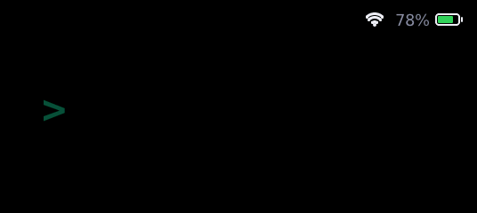</td>
  </tr>
</table>

## What the screen shows

While a task runs you get your prompt, the current step ("Editing auth.ts", "$ npm test"), a segmented progress bar built from the agent's plan (up to 12 items), a "3/7" counter with a percentage, and elapsed time. The status pill and the bar change color with the state:

| State | Claude theme | Codex theme | When |
|---|---|---|---|
| Start | 🔴 Red | ⚪ White | You sent a task, the agent is thinking |
| Working | 🟠 Orange | 🟢 ChatGPT green | The agent is calling tools: editing files, running commands |
| Waiting for you | 🟡 Yellow | 🟡 Amber | The agent asks for permission |
| Done | 🟢 Green | 🟢 Light mint | The task is finished |
| Error | 🩷 Pink-red | 🔴 Red | A tool failed or the task was interrupted (rate limit, server error) |
| Compacting | 🩵 Cyan | 🔵 Blue | The agent is compacting its context |
| Idle | ⚪ Gray | ⚪ Gray | No active task: the idle scene plays |

Animations are made with LVGL: smooth color transitions, segment fills, a pulsing current step (faster while waiting for you) and a left-to-right wave on completion. After 10 idle minutes the mascot falls asleep and the screen dims; after 30 it turns off to protect the AMOLED from burn-in.

### Every screen in both themes

Every GIF here is rendered by the **real firmware UI code** running in the [simulator](#firmware-simulator), not drawn separately — each scenario in both themes. Regenerate them all with `python tools/sim/render_docs.py`.

<table align="center">
  <tr>
    <th width="50%">Claude</th>
    <th width="50%">Codex</th>
  </tr>
  <tr>
    <td colspan="2"><b>A task from start to finish</b> — Red start while the agent thinks, then work: the step text changes, plan segments fill, the current one pulses. A permission request turns everything yellow; on “Done” the bar fills in a wave, the pill hops and confetti flies.</td>
  </tr>
  <tr>
    <td align="center"></td>
    <td align="center"></td>
  </tr>
  <tr>
    <td colspan="2"><b>Errors</b> — A failed tool shakes the status pill and turns the step red; the next tool call returns to work. A task that stops on a rate limit or a server error stays red with the reason.</td>
  </tr>
  <tr>
    <td align="center">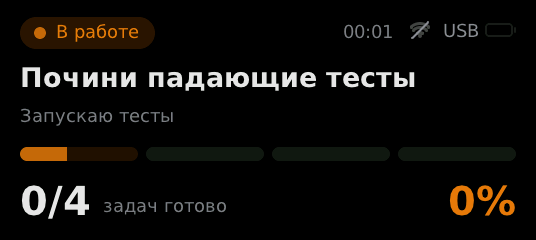</td>
    <td align="center">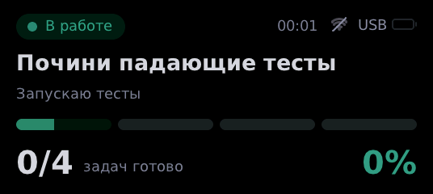</td>
  </tr>
  <tr>
    <td colspan="2"><b>Subagents and compaction</b> — A badge counts running subagents (×3). While the context is compacted, the progress bar squeezes up and down.</td>
  </tr>
  <tr>
    <td align="center">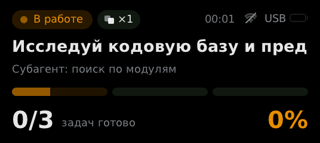</td>
    <td align="center">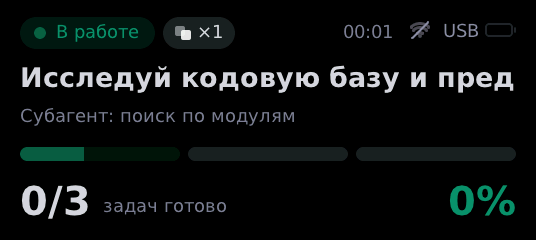</td>
  </tr>
  <tr>
    <td colspan="2"><b>Waiting too long</b> — After a minute without your answer the label shows how long it has waited and the screen edge starts to flash.</td>
  </tr>
  <tr>
    <td align="center">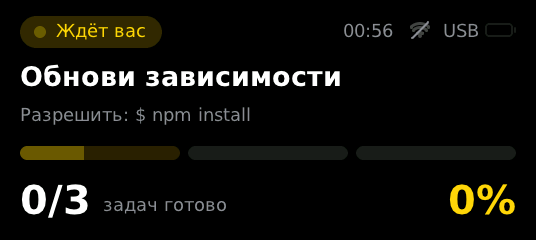</td>
    <td align="center">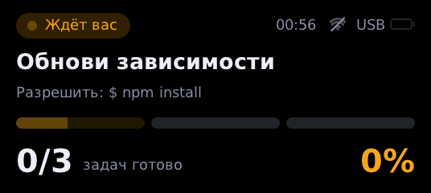</td>
  </tr>
  <tr>
    <td colspan="2"><b>Button: approve, deny, next scene, mute</b> — Hold to allow, tap to deny (Claude Code, opt-in). A double press switches the idle scene, a long press mutes — the crossed-out speaker stays in the corner.</td>
  </tr>
  <tr>
    <td align="center"></td>
    <td align="center">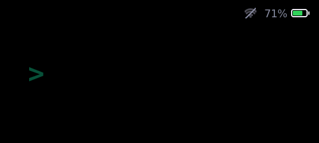</td>
  </tr>
  <tr>
    <td colspan="2"><b>Battery, charging and Wi-Fi</b> — Green above 50%, orange 21–50%, red 20% and below; while charging a bolt appears and the fill sweeps to full. The Wi-Fi fan shows signal strength.</td>
  </tr>
  <tr>
    <td align="center">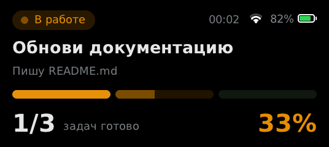</td>
    <td align="center">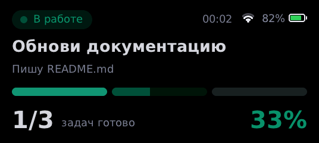</td>
  </tr>
  <tr>
    <td colspan="2"><b>Link lost</b> — The daemon pings every 5 s. After 15 s of silence (laptop asleep, cable out) the screen dims and says so in the middle, instead of showing a stale status as if it were current.</td>
  </tr>
  <tr>
    <td align="center">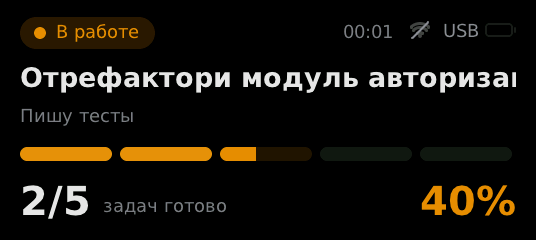</td>
    <td align="center">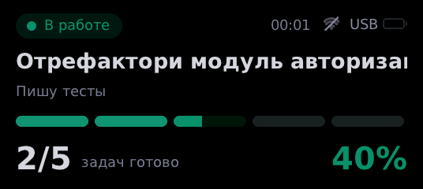</td>
  </tr>
  <tr>
    <td colspan="2"><b>Into work and back</b> — A task arrives: the mascot leaps out of frame and the task screen slides in. After “Done”, or when the session closes, the task screen fades and the idle scene starts over.</td>
  </tr>
  <tr>
    <td align="center">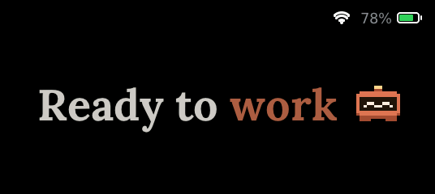</td>
    <td align="center"></td>
  </tr>
  <tr>
    <td colspan="2"><b>Sleep</b> — After 10 minutes without events the mascot dozes off, “z z z” float up and the screen dims. After 30 minutes the screen turns off so the AMOLED does not burn in. Any event wakes it.</td>
  </tr>
  <tr>
    <td align="center">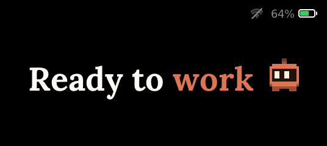</td>
    <td align="center">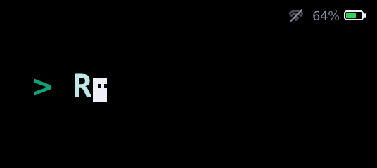</td>
  </tr>
  <tr>
    <td colspan="2"><b>Pairing screen</b> — A six-digit code over everything when the host sends <code>{"pair":"482913"}</code>. Ready for the Wi-Fi mode; the Wi-Fi transport itself is not implemented yet.</td>
  </tr>
  <tr>
    <td align="center">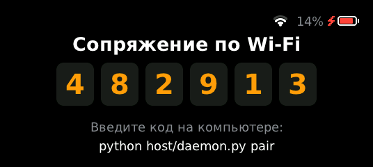</td>
    <td align="center">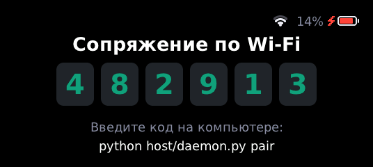</td>
  </tr>
  <tr>
    <td align="center" valign="top">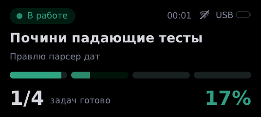<br><b>Several sessions</b><br>Codex works in one terminal, Claude asks for permission in another: the screen shows whatever needs you, the rest is a “+1 session” badge and the theme follows the session on screen.</td>
    <td align="center" valign="top"><br><b>Boot splash</b><br>Both mascots drop in and bounce, then the name and version fade in. Battery and Wi-Fi are already in the corner.</td>
  </tr>
</table>

### Themes

The screen follows whichever agent sent the latest event.

- **Claude** — warm orange accents, Lora serif for the idle scenes, DejaVu Sans for the task screen.
- **Codex** — black, white and ChatGPT green `#10A37F`, monospace type like a terminal.

> The firmware switches colors, mascots and idle scenes per theme. A monospace font for the Codex task screen is planned; for now both task screens use DejaVu Sans.

Mascots are original pixel characters made for this project; no logos or brand characters are used.

### Idle scenes — pick one

Each theme has two idle scenes. Every scene ends with the mascot leaping at the camera and melting into the theme color, then loops seamlessly. These GIFs are recorded from the firmware in the simulator.

<table align="center">
  <tr>
    <td align="center"><br><b>Claude · <code>robot</code></b> (default)<br>A pixel robot drops onto the text and hops letter by letter; each letter dips under it and lights up.</td>
    <td align="center">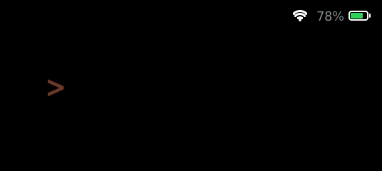<br><b>Claude · <code>cursor</code></b><br>An orange cursor wakes up, opens its eyes and types the line, leaving letters behind as it hops.</td>
  </tr>
  <tr>
    <td align="center"><br><b>Codex · <code>cursor</code></b> (default)<br>The terminal cursor comes alive and types the command; when it blinks, its eyes stay hanging in the air.</td>
    <td align="center">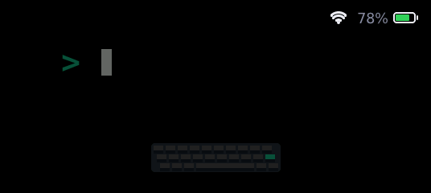<br><b>Codex · <code>typist</code></b><br>A slime sits at a pixel keyboard, taps the keys with two stubby paws and slams Enter.</td>
  </tr>
</table>

Choose a scene per theme with environment variables for the daemon:

```bash
AGENT_STATUS_IDLE_CLAUDE=cursor     # robot | cursor
AGENT_STATUS_IDLE_CODEX=typist      # cursor | typist
```

### Battery and Wi-Fi

The top-right corner is the same on every screen — boot splash, idle scenes, the task screen and pairing. Battery: green above 50%, orange from 21 to 50%, red at 20% and below; while charging a bolt appears next to it and the fill sweeps to full; without a cell the outline is empty and labeled *USB*. Wi-Fi: a dot and three arcs by signal strength; while the board works over USB (Wi-Fi mode is not implemented yet) the fan is dim and crossed out. A crossed-out speaker appears while sound is muted. During the full-screen finale of an idle scene the indicators step aside.

The battery is measured on GPIO4 through the board's 1:2 divider and converted to percent with a Li-ion discharge curve (`firmware/main/platform_esp.c`).

> The on-screen labels are in Russian for now. They live in `state_text()` in `firmware/main/ui_status.c` and in `host/adapters/common.py`.

### Button and sound

The board's BOOT button (GPIO0) works without any wiring:

| Press | Does |
|---|---|
| Short | Switches between the idle scene and the last task |
| Double | Next idle scene for the current theme; the choice is sent to the daemon and kept |
| Long (1.2 s) | Mutes or unmutes sounds |
| Any, while the screen sleeps | Wakes it |

**Approve from the board (Claude Code, opt-in).** Set `AGENT_STATUS_BUTTON_APPROVE=1` and, when Claude asks for permission, the screen shows *hold — allow · press — deny* with a fill bar. Hold to allow, tap to deny. If nobody presses within `AGENT_STATUS_APPROVE_WAIT` seconds (20 by default), the hook steps aside and Claude Code shows its usual prompt — so for that time the prompt in the terminal appears a little later. Codex hooks cannot answer permission requests, so there the screen only shows that it is waiting.

A passive buzzer is optional: connect it through a ~100 Ω resistor between a free GPIO (for example 43 or 44) and GND, and set *Buzzer GPIO* in `idf.py menuconfig → Agent Status Bar`. The board then chirps on *waiting*, *done* and *error*, repeats the reminder every minute while you are away, and clicks on button actions. A second button pin can be set in the same menu.

## How it works

```
Claude Code ─┐
             ├─ hook ─▶ hooks/forward.py ─ HTTP ─▶ host/daemon.py ─ USB ─▶ ESP32-S3
Codex ───────┘                                      └ adapters/claude.py, codex.py
```

1. Plugin hooks call `hooks/forward.py` on every agent event.
2. The hook forwards the event to a local daemon at `127.0.0.1:8765` and exits immediately, so the agent is never slowed down. If the daemon is not running, the hook starts it.
3. The daemon translates the event into a screen state through an agent-specific adapter and sends one JSON line to the board over USB.
4. The firmware knows nothing about agent internals: it draws `state`, `title`, `step`, `done` and `total`, and picks the theme and idle scene from `agent` and `idle`.

## Hardware

- [LilyGO T-Display-S3 AMOLED](https://github.com/Xinyuan-LilyGO/T-Display-S3-AMOLED): ESP32-S3R8, 8 MB PSRAM, 1.91″ 536×240 AMOLED (RM67162 over QSPI).
- A USB-C data cable.

No soldering required.

### Case

`hardware/case/` has a three-part 3D-printable case: a tray with room for a small Li-ion cell under the board and openings for USB-C and the side buttons, a screen bezel that snaps in, and a 22° desk stand. The STL files are ready to slice (PLA, 0.2 mm layers, no supports; print the bezel face down). Assembled it is about 65 × 30 × 19 mm.

<p align="center">
  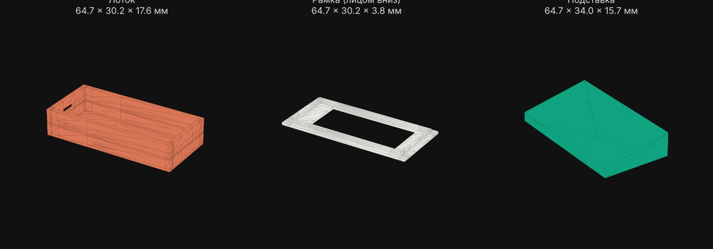
</p>

Dimensions come from the board specs (60 × 25.5 × 10 mm), not from a drawing — measure your board and change `PARAMS` in `hardware/case/case.py` (or the variables in `case.scad` for OpenSCAD), then run `python hardware/case/case.py` (needs `numpy` and `matplotlib`) to regenerate the STL. LilyGO also publishes an official case model in the [board repository](https://github.com/Xinyuan-LilyGO/T-Display-S3-AMOLED) (`shell/`).

## Installation

### 1. Flash the board

You need [ESP-IDF](https://docs.espressif.com/projects/esp-idf/) 5.1 or newer. LVGL 9.2 is fetched automatically by the component manager.

```bash
cd firmware
idf.py set-target esp32s3
idf.py build flash
```

If flashing fails, hold BOOT, press RST, release BOOT.

### 2. Install the Python dependency

```bash
pip install pyserial
```

### 3. Install the plugin

**Claude Code**

```
/plugin marketplace add YOUR_GITHUB_USERNAME/agent-status-bar
/plugin install agent-status-bar@agent-status-bar
```

**Codex**

```bash
codex plugin marketplace add YOUR_GITHUB_USERNAME/agent-status-bar
```

Then install **Agent Status Bar** from the plugin list. Codex does not trust plugin hooks automatically: review and enable them when Codex asks.

That's it. The first agent event starts the daemon, which finds the board by its Espressif USB VID.

On Windows the hook command is `python3`. If your Python is only available as `python`, edit the commands in `hooks/hooks.json` and `hooks/codex-hooks.json`.

## Try it without a board

### Firmware simulator

`tools/sim/` builds the firmware's own UI code (`firmware/main/ui_*.c`, `protocol.c`) with LVGL 9.2 on your computer, plays a scenario and saves a GIF. No board, no ESP-IDF:

```bash
pip install pillow                     # plus cmake and a C compiler
python tools/sim/render.py tools/sim/scenarios/error.txt error.gif
python tools/sim/render.py tools/sim/scenarios/wait_escalation.txt wait.gif --clip 57-68
```

A scenario is a text file of `<time_ms> <JSON line>`, exactly what the daemon sends to the board. CI runs every scenario in `tools/sim/scenarios/`, so a change that breaks the screen code fails the build.

### Browser emulator

Open [`docs/emulator.html`](docs/emulator.html) in a browser. It reproduces the interface in JavaScript with the same colors, sizes and timings; the buttons simulate hook events.

You can also run the daemon in demo mode or poke it with curl:

```bash
python host/daemon.py --demo
curl -X POST "http://127.0.0.1:8765/?agent=claude" -d '{"hook_event_name":"UserPromptSubmit","prompt":"Test"}'
curl -X POST "http://127.0.0.1:8765/?agent=claude" -d '{"hook_event_name":"Stop"}'
curl http://127.0.0.1:8765/   # current state
```

## Protocol

The daemon sends one JSON line per update:

```json
{"state":"work","title":"Refactor the auth module","step":"Writing tests","done":3,"total":5,"sub":2,"others":1,"agent":"claude","idle":"robot"}
{"ping":1}
```

| Field | Meaning |
|---|---|
| `state` | `idle`, `start`, `work`, `wait`, `done`, `error`, `compact` |
| `title`, `step` | Prompt and current step; omit to keep the previous text |
| `done`, `total` | Plan progress, `total` is clamped to 1–12 |
| `sub` | Running subagents (badge hidden at 0) |
| `others` | Other active sessions (badge hidden at 0) |
| `agent` | Theme: `claude` or `codex` |
| `idle` | Idle scene for the theme |
| `ping` | Keep-alive, sent every 5 s; 15 s of silence shows “link lost” |
| `pair` | Six-digit pairing code to show; `""` hides the pairing screen |
| `approve` | `true` — the board offers hold-to-allow / tap-to-deny for the current wait |

The board sends lines back on button actions: `{"button":"approve"}`, `{"button":"deny"}`, `{"button":"scene_next","scene":"cursor"}`.

Every field is optional; the board remembers the last value. Anything that can write to a serial port can drive the display, not just coding agents.

### Events the daemon listens to

| Screen | Claude Code | Codex |
|---|---|---|
| Start | `UserPromptSubmit` | `UserPromptSubmit` |
| Work, current step | `PreToolUse`, `PostToolUse` | `PreToolUse`, `PostToolUse` |
| Plan progress | `TaskCreated`, `TaskCompleted`, `TaskUpdate`, legacy `TodoWrite` | `update_plan` |
| Waiting for you | `PermissionRequest`, `Notification` (permission and input prompts) | `PermissionRequest` |
| Error | `PostToolUseFailure`, `StopFailure` | non-zero exit code in `PostToolUse` |
| Subagents | `SubagentStart`, `SubagentStop` | `SubagentStart`, `SubagentStop` |
| Compacting | `PreCompact`, `PostCompact` | `PreCompact`, `PostCompact` |
| Done | `Stop` | `Stop` |
| Session closed | `SessionEnd` | — |

## Adding another agent

Create `host/adapters/<name>.py` with a `NAME` string and a `handle(event, state, ctx)` function that updates `state` and returns `True` when the screen should be redrawn, register it in `host/adapters/__init__.py`, and point the agent's hooks at `hooks/forward.py <name>`.

## Configuration

| What | Where |
|---|---|
| State colors per theme | `THEMES` in `firmware/main/ui_status.c` |
| State labels | `STATE_TEXT` in `firmware/main/ui_status.c` |
| When waiting starts to nag | `UI_WAIT_ESCALATE_MS` in `firmware/main/ui_status.h` (60 s) |
| Link-lost timeout | `PROTO_LINK_TIMEOUT_MS` in `firmware/main/protocol.h` (15 s) |
| How long “Done” stays before the idle scene | `UI_DONE_TO_IDLE_MS` in `firmware/main/ui_screen.h` (90 s) |
| Mascot falls asleep, screen dims | `UI_SLEEP_AFTER_MS`, `UI_BRIGHT_SLEEP` in the same file (10 min) |
| Screen turns off | `UI_OFF_AFTER_MS` in the same file (30 min) |
| Battery pin and thresholds | `BAT_ADC_CHANNEL`, `BAT_NO_BATTERY_MV`, `BAT_USB_MV` in `firmware/main/platform_esp.c` |
| Normal brightness | `UI_BRIGHT_ON` in `firmware/main/ui_screen.h` |
| Mirrored or upside-down image | `LCD_MADCTL` in `firmware/main/display_rm67162.c`: `0x60`, `0xA0`, `0x20`, `0xE0` |
| Stripes or artifacts | lower `LCD_FREQ` to 40 MHz in the same file |
| Font | replace the TTF files in `firmware/main/fonts/` (keep the names) |
| Daemon port | `AGENT_STATUS_PORT` environment variable |
| Serial port | `AGENT_STATUS_SERIAL` environment variable, e.g. `COM5` |
| Disable daemon autostart | `AGENT_STATUS_AUTOSTART=0` |
| Idle scene, Claude theme | `AGENT_STATUS_IDLE_CLAUDE`: `robot` (default) or `cursor` |
| Idle scene, Codex theme | `AGENT_STATUS_IDLE_CODEX`: `cursor` (default) or `typist` |
| Approve from the board | `AGENT_STATUS_BUTTON_APPROVE=1` (Claude Code only) |
| How long the hook waits for the button | `AGENT_STATUS_APPROVE_WAIT`, seconds (20, max 120) |
| Button, second button, buzzer pins | `idf.py menuconfig → Agent Status Bar` |
| Long-press and double-press timing | `UI_LONG_PRESS_MS`, `UI_DOUBLE_CLICK_MS` in `firmware/main/ui_input.h` |

## Regenerating the previews

Firmware GIFs (everything in `docs/firmware/`, both themes) come from the simulator:

```bash
pip install pillow
python tools/sim/render_docs.py                   # all of them, ~1.5 min
python tools/sim/render_docs.py task button       # just these
```

The original design previews in Python:

```bash
python tools/render_task.py --theme claude        # docs/claude_task.gif
python tools/render_task.py --theme codex         # docs/codex_task.gif
python tools/render_idle_robot.py                 # docs/claude_idle_robot.gif
python tools/render_idle_cursor.py --theme claude # docs/claude_idle_cursor.gif
python tools/render_idle_cursor.py --theme codex  # docs/codex_idle_cursor.gif
python tools/render_idle_typist.py                # docs/codex_idle_typist.gif
```

Fonts used by the renderers live in `tools/fonts/` with their licenses (Lora — SIL OFL 1.1, DejaVu — Bitstream Vera license).

## Project layout

```
.claude-plugin/        Claude Code plugin and marketplace manifests
.codex-plugin/         Codex plugin manifest
.agents/plugins/       Codex marketplace manifest
hooks/                 hook definitions and forward.py
host/                  daemon.py, sessions.py (several sessions at once) and per-agent adapters
firmware/main/         ESP-IDF project, LVGL 9:
  ui_status.c            task screen, themes, scenario states
  ui_scene_*.c           idle scenes (robot, cursor, typist), ui_scene.c runs them
  ui_screen.c            splash, transitions, confetti, sleep, pairing
  ui_icons.c             battery and Wi-Fi indicators
  protocol.c             JSON lines from the host (shared with the simulator)
  ui_input.c, ui_sound.c button actions and melodies
  platform_esp.c         brightness, battery ADC, buzzer; input_esp.c — buttons; display_rm67162.c — the panel driver
hardware/case/         3D-printable case: case.py (generator), case.scad, STL, preview
docs/firmware/         firmware GIFs: claude/ and codex/ — every screen in both themes; browser emulator in docs/
tools/                 renderers for the design previews
tools/sim/             firmware simulator: real UI code + LVGL on a PC, scenarios, GIF export
```

## Status

The daemon, adapters, session handling and idle-scene selection are covered by tests. Every screen, scene and animation runs in the firmware simulator and in CI. The display driver follows the RM67162 pinout and protocol from the LilyGO and ESPHome examples but has not yet been run on real hardware, so the first build may need the tweaks from the table above. The Codex adapter assumes the `update_plan` tool format; if your Codex version differs, adjust `_plan_steps()` in `host/adapters/codex.py`.

Issues with error output or a photo of the screen are very welcome.

## License

[MIT](LICENSE)
