<p align="center">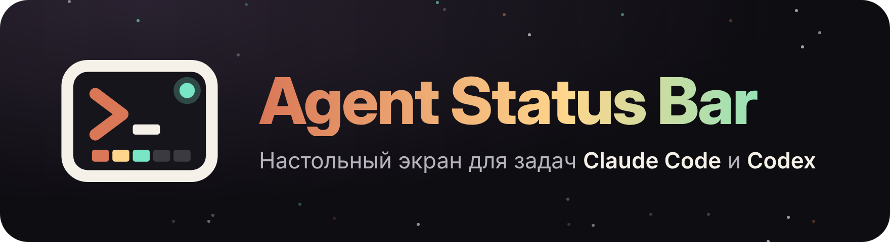</p>

# Agent Status Bar

[English](README.md) · **Русский**

Физический индикатор прогресса для задач [Claude Code](https://claude.com/claude-code) и [OpenAI Codex](https://developers.openai.com/codex) на ESP32-S3 с цветным дисплеем (LilyGO T-Display-S3, LCD или AMOLED). Пока агент работает, на столе видно, чем он занят, сколько пунктов плана выполнено и не ждёт ли он вашего подтверждения.

<table align="center">
  <tr>
    <th></th>
    <th>Работа над задачей</th>
    <th>Готов к работе</th>
  </tr>
  <tr>
    <td><b>Claude</b></td>
    <td></td>
    <td></td>
  </tr>
  <tr>
    <td><b>Codex</b></td>
    <td></td>
    <td>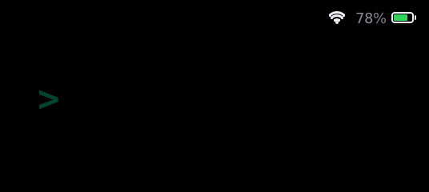</td>
  </tr>
</table>

> **Впервые собираете?** [Установка с нуля по шагам](#установка-с-нуля-по-шагам) — от покупки платы до статусов на экране, без ESP-IDF. Что-то пошло не так — [Если что-то не работает](#если-что-то-не-работает).

## Что показывает экран

Пока идёт задача, на экране видно текст вашего запроса, текущий шаг («Правит auth.ts», «$ npm test»), сегментированную полосу прогресса по плану агента (до 12 пунктов), счётчик «3/7» с процентом и время с начала задачи. Пилюля статуса и полоса меняют цвет по состоянию:

| Состояние | Тема Claude | Тема Codex | Когда |
|---|---|---|---|
| Старт | 🔴 Красный | ⚪ Белый | Вы отправили задачу, агент думает |
| В работе | 🟠 Оранжевый | 🟢 Зелёный ChatGPT | Агент вызывает инструменты: правит файлы, запускает команды |
| Ждёт вас | 🟡 Жёлтый | 🟡 Янтарный | Агент просит разрешение на действие |
| Готово | 🟢 Зелёный | 🟢 Светлый мятный | Задача завершена |
| Ошибка | 🩷 Розово-красный | 🔴 Красный | Упал инструмент или задача прервалась (лимит запросов, ошибка сервера) |
| Сжатие | 🩵 Голубой | 🔵 Синий | Агент сжимает контекст |
| Ожидание | ⚪ Серый | ⚪ Серый | Задачи нет, играет сцена ожидания |

Анимации сделаны на LVGL: плавная смена цвета, заливка сегментов, пульсация текущего шага (быстрее, когда агент ждёт вас) и волна слева направо при завершении. Через 10 минут простоя маскот засыпает и экран тускнеет, через 30 — гаснет, чтобы AMOLED не выгорал.

### Все экраны в обеих темах

Все гифки здесь отрисованы **настоящим кодом экрана прошивки** в [симуляторе](#симулятор-прошивки), а не нарисованы отдельно — каждый сценарий в обеих темах. В [английском README](README.md) те же экраны на английском. Пересобрать все: `python tools/sim/render_docs.py`.

<table align="center">
  <tr>
    <th width="50%">Claude</th>
    <th width="50%">Codex</th>
  </tr>
  <tr>
    <td colspan="2"><b>Задача от старта до финиша</b> — Красный старт, пока агент думает, потом работа: меняется текст шага, заполняются сегменты плана, текущий пульсирует. Запрос разрешения красит всё в жёлтый; на «Готово» полоса заливается волной, пилюля подпрыгивает и летят конфетти.</td>
  </tr>
  <tr>
    <td align="center"></td>
    <td align="center"></td>
  </tr>
  <tr>
    <td colspan="2"><b>Ошибки</b> — Упавший инструмент трясёт пилюлю статуса и красит шаг в красный; следующий вызов возвращает в работу. Если задача остановилась на лимите запросов или ошибке сервера, экран остаётся красным с причиной.</td>
  </tr>
  <tr>
    <td align="center">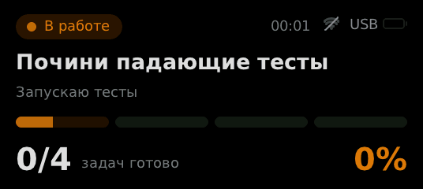</td>
    <td align="center">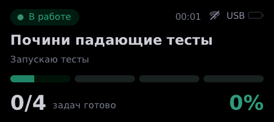</td>
  </tr>
  <tr>
    <td colspan="2"><b>Субагенты и сжатие</b> — Бейдж считает запущенных субагентов (×3). Пока контекст сжимается, полоса прогресса «утрамбовывается».</td>
  </tr>
  <tr>
    <td align="center">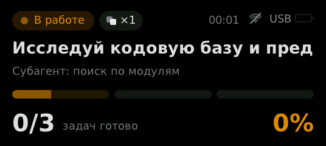</td>
    <td align="center">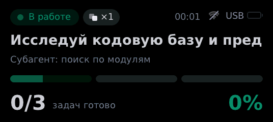</td>
  </tr>
  <tr>
    <td colspan="2"><b>Долгое ожидание</b> — Через минуту без ответа в подписи появляется, сколько агент ждёт, а край экрана начинает мигать.</td>
  </tr>
  <tr>
    <td align="center">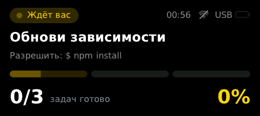</td>
    <td align="center">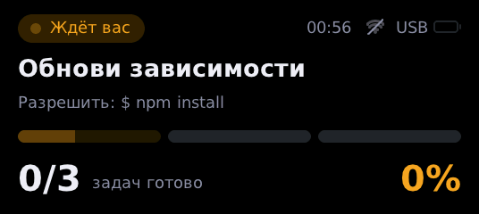</td>
  </tr>
  <tr>
    <td colspan="2"><b>Кнопка: разрешить, отклонить, сцена, звук</b> — Удержали — разрешено, нажали — отклонено (Claude Code). Если ответить кнопкой нельзя, плата подсказывает «Ответьте на компьютере». В остальное время двойное нажатие меняет сцену ожидания, долгое выключает звук — перечёркнутый динамик остаётся в углу.</td>
  </tr>
  <tr>
    <td align="center">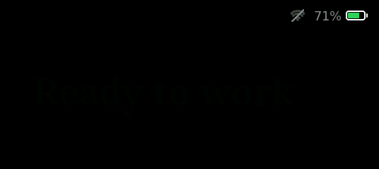</td>
    <td align="center">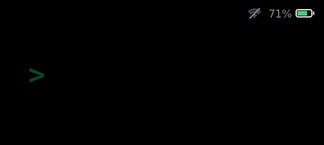</td>
  </tr>
  <tr>
    <td colspan="2"><b>Батарея, зарядка и Wi-Fi</b> — Зелёная выше 50%, оранжевая 21–50%, красная 20% и ниже; при зарядке появляется молния и заливка бежит до полной. Веер Wi-Fi показывает уровень сигнала.</td>
  </tr>
  <tr>
    <td align="center">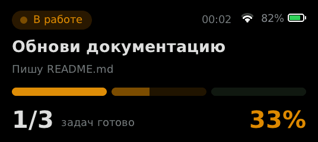</td>
    <td align="center">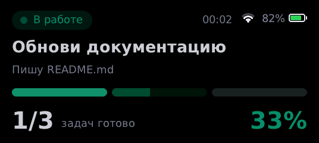</td>
  </tr>
  <tr>
    <td colspan="2"><b>Нет связи</b> — Демон пингует каждые 5 с. После 15 с тишины (ноутбук уснул, кабель выдернут) экран тускнеет, а сверху появляется плашка, а не показывает устаревший статус как текущий.</td>
  </tr>
  <tr>
    <td align="center">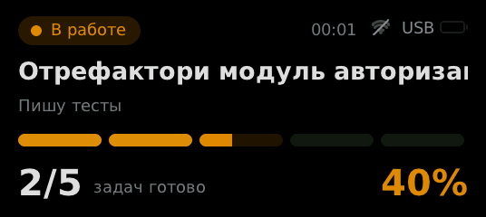</td>
    <td align="center">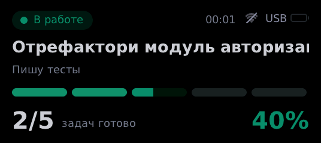</td>
  </tr>
  <tr>
    <td colspan="2"><b>В работу и обратно</b> — Пришла задача: маскот выпрыгивает из кадра, выезжает экран задачи. После «Готово» или когда сессия закрылась, экран задачи гаснет и сцена ожидания начинается заново.</td>
  </tr>
  <tr>
    <td align="center">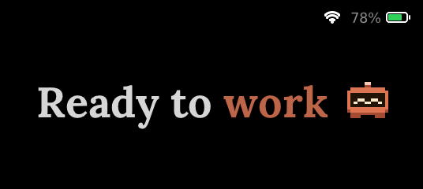</td>
    <td align="center"></td>
  </tr>
  <tr>
    <td colspan="2"><b>Сон</b> — Через 10 минут без событий маскот засыпает, всплывают «z z z», экран тускнеет. Через 30 минут экран гаснет совсем, чтобы AMOLED не выгорал. Любое событие будит.</td>
  </tr>
  <tr>
    <td align="center">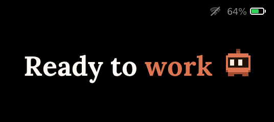</td>
    <td align="center">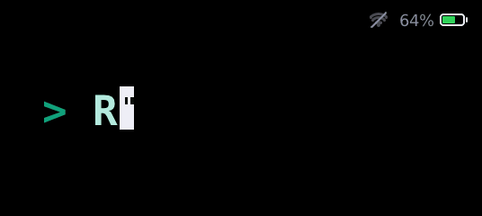</td>
  </tr>
  <tr>
    <td colspan="2"><b>Экран сопряжения</b> — Когда компьютер проходит сопряжение с платой по Wi-Fi, один и тот же шестизначный код появляется в его консоли и на плате — как при сопряжении Bluetooth. Нажать кнопку — подтвердить, удержать — отменить. См. <a href="#wi-fi">Wi-Fi</a>.</td>
  </tr>
  <tr>
    <td align="center">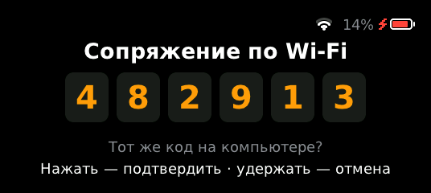</td>
    <td align="center">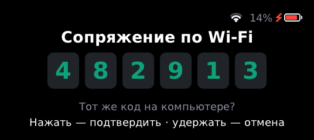</td>
  </tr>
  <tr>
    <td align="center" valign="top">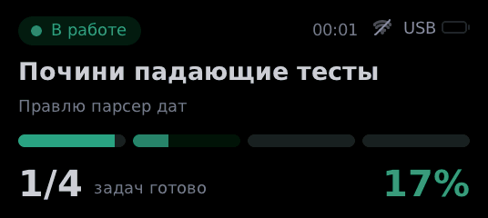<br><b>Несколько сессий</b><br>Codex работает в одном терминале, Claude спрашивает разрешение в другом: на экране то, что требует вас, остальное — бейдж «+1 сессия», тема следует за сессией на экране.</td>
    <td align="center" valign="top"><br><b>Заставка</b><br>Сначала в центре рисуется логотип — подсказка «>_», деления прогресса, точка «в эфире» — и перелетает к названию; звёздное небо, маскоты по очереди прыгают и пускают сердечки, название переливается, внизу — статус Wi-Fi и полоска загрузки. Ждёт Wi-Fi до 15 секунд и уходит, как только сеть подключилась; кнопка — пропустить.</td>
  </tr>
</table>

### Темы

Экран переключается на тему того агента, который прислал событие последним.

- **Claude** — тёплые оранжевые акценты, антиква Lora в сценах ожидания, DejaVu Sans на экране задачи.
- **Codex** — чёрный, белый и фирменный зелёный ChatGPT `#10A37F`, моноширинный шрифт в сценах ожидания, как в терминале.

> Прошивка переключает по теме цвета, маскотов и сцены ожидания. Моноширинный шрифт для экрана задачи Codex запланирован; пока оба экрана задачи рисуются шрифтом DejaVu Sans.

Маскоты — оригинальные пиксельные персонажи, нарисованные для этого проекта; логотипы и фирменные персонажи не используются.

### Сцены ожидания — на выбор

У каждой темы по две сцены ожидания. Каждая заканчивается тем, что маскот прыгает в камеру и растворяется в цвете темы, после чего сцена бесшовно начинается заново. Гифки записаны с прошивки в симуляторе.

<table align="center">
  <tr>
    <td align="center"><br><b>Claude · <code>robot</code></b> (по умолчанию)<br>Пиксельный робот падает на текст и скачет по буквам; каждая буква проседает под ним и загорается.</td>
    <td align="center">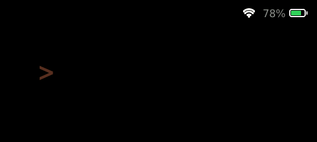<br><b>Claude · <code>cursor</code></b><br>Оранжевый курсор просыпается, открывает глаза и печатает строку, оставляя за собой буквы.</td>
  </tr>
  <tr>
    <td align="center"><br><b>Codex · <code>cursor</code></b> (по умолчанию)<br>Курсор терминала оживает и печатает команду; когда он мигает, глаза остаются висеть в воздухе.</td>
    <td align="center">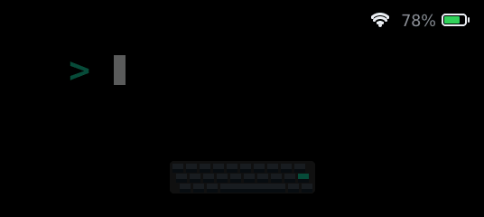<br><b>Codex · <code>typist</code></b><br>Слайм сидит за пиксельной клавиатурой, стучит по клавишам двумя лапками и бьёт по Enter.</td>
  </tr>
</table>

Сцену для каждой темы выберите в [файле настроек](#файл-настроек) (`idle_claude`, `idle_codex`) или переключайте двойным нажатием на плате — выбор запоминается.

### Батарея и Wi-Fi

Правый верхний угол одинаковый на всех экранах — на заставке, в сценах ожидания, на экране задачи и при сопряжении. Батарея: зелёная выше 50%, оранжевая от 21 до 50%, красная 20% и ниже; при зарядке рядом появляется молния, а заливка бежит до полной; без аккумулятора корпус пустой с подписью «USB». Wi-Fi: точка и три дуги по уровню сигнала; тусклый перечёркнутый веер — плата не в сети Wi-Fi. Перечёркнутый динамик — звук выключен. В финале сцены ожидания, когда экран заливается цветом, индикаторы на секунду уступают.

Напряжение измеряется на GPIO4 через делитель 1:2 на плате и переводится в проценты по кривой разряда Li-ion (`firmware/main/platform_esp.c`).

> Экран говорит по-английски и по-русски — см. [файл настроек](#файл-настроек).

### Кнопка и звук

Кнопка BOOT на плате (GPIO0) работает без пайки:

| Нажатие | Что делает |
|---|---|
| Короткое | Переключает между сценой ожидания и последней задачей |
| Двойное | Следующая сцена ожидания для текущей темы; выбор уходит демону и запоминается |
| Долгое (1,2 с) | Выключает и включает звук |
| Любое, пока экран спит | Будит его |

**Разрешение с платы (Claude Code и чат claude.ai).** Включено по умолчанию, если плата на связи: когда Claude спросит разрешение, на экране появится «Удержать — разрешить · нажать — отклонить» с полосой заполнения. Удержали — разрешено, нажали — отклонено. Вопрос с вариантами (*AskUserQuestion*) показывается как «Вопрос → первый вариант»: удержали — выбран этот первый вариант, нажали — вопрос пропущен. Если за `approve_wait` секунд (по умолчанию 60) никто не нажал, хук уступает, и Claude Code показывает свой обычный запрос — то есть на это время запрос в терминале появляется чуть позже. В чате claude.ai то же делает расширение браузера: когда инструмент просит разрешение, удержите кнопку — расширение нажмёт в чате «Разрешить один раз» (никогда не «Разрешать всегда»), нажмите коротко — «Отклонить»; можно ответить и прямо в чате, тогда подсказка с платы пропадёт. Хуки Codex не умеют отвечать на запросы разрешения, поэтому там экран только показывает, что агент ждёт, а нажатие подсказывает «Ответьте на компьютере» (а не выключает звук и не листает сцены). Если в вашем `config.toml` осталась строка `button_approve = false` (её записывал `config --init` старых версий), включите: `py -3 host\daemon.py config set button_approve true`; выключить — то же с `false`. Ждать дольше или меньше — `config set approve_wait 40`.

Пищалка не обязательна: пассивный зуммер через резистор ~100 Ом между свободным GPIO (например, 43 или 44) и GND, затем *Buzzer GPIO* в `idf.py menuconfig → Agent Status Bar`. Плата пищит на «ждёт вас», «готово» и «ошибка», повторяет напоминание каждую минуту, пока вас нет, и щёлкает на нажатиях. Там же можно задать пин второй кнопки.

## Как это работает

```
Claude Code ─┐
             ├─ хук ─▶ hooks/forward.py ─ HTTP ─▶ host/daemon.py ─┬─ USB ─────────────────▶ ESP32-S3
Codex ───────┘                                      │             └─ Wi-Fi (TCP 8766) ───▶ ESP32-S3
                                                    └ adapters/claude.py, codex.py
```

1. Хуки плагина вызывают `hooks/forward.py` на каждое событие агента.
2. Хук пересылает событие локальному демону на `127.0.0.1:8765` и сразу завершается, поэтому агент не тормозит. Если демон не запущен, хук сам его поднимает.
3. Демон переводит событие в состояние экрана через адаптер конкретного агента и отправляет плате строку JSON по USB или, без кабеля, по [Wi-Fi](#wi-fi).
4. Прошивка не знает внутренностей агентов: она рисует `state`, `title`, `step`, `done` и `total`, а тему, сцену ожидания и язык берёт из полей `agent`, `idle` и `lang`.

## Железо

Одна из двух плат LilyGO (ESP32-S3R8, 8 МБ PSRAM, 16 МБ флеш) и USB-C кабель с передачей данных:

| Плата | Экран | Как показывается интерфейс |
|---|---|---|
| [T-Display-S3](https://github.com/Xinyuan-LilyGO/T-Display-S3) | LCD 1,9″ 320×170, ST7789, 8-битная параллельная шина | Плавно уменьшен до 320×143 и стоит по центру; физически того же размера, просто точки крупнее |
| [T-Display-S3 AMOLED](https://github.com/Xinyuan-LilyGO/T-Display-S3-AMOLED) | AMOLED 1,91″ 536×240, RM67162, QSPI | Точка в точку, как на гифках выше |

Платы почти не отличить на вид. Отличаются экраном: AMOLED там, где картинка чёрная, совсем чёрный, а у LCD есть подсветка, которая светится серым. Прошивка для другой платы оставит экран чёрным (или только с подсветкой).

Паять ничего не нужно.

### Корпус

**T-Display-S3 (LCD) + аккумулятор 103565** — в [`hardware/case/lcd/`](hardware/case/lcd/). Три печатные детали, 94,2 × 44,1 × 29,3 мм без щёк. Плата, её кнопки и разъёмы расставлены по официальной 3D-модели T-Display-S3 от LilyGO (`dimensions/t-display-s3-full.stl` в их репозитории): плата 60,8 × 26 × 9,9 мм. Корпус сам стоит на столе, экран под 60° к столу: торцевые стенки переходят в скруглённые боковые щёки с вырезами — одной деталью с корпусом. На лице выгравирован логотип проекта (0,5 мм), на длинных стенках — ряд наклонных декоративных прорезей глубиной 1 мм.

<p align="center">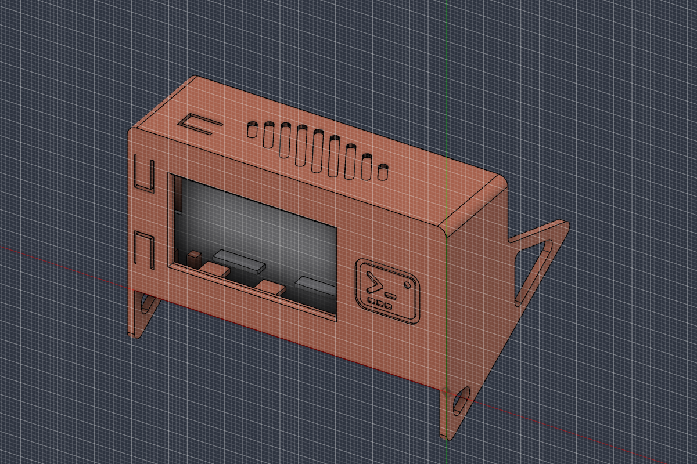 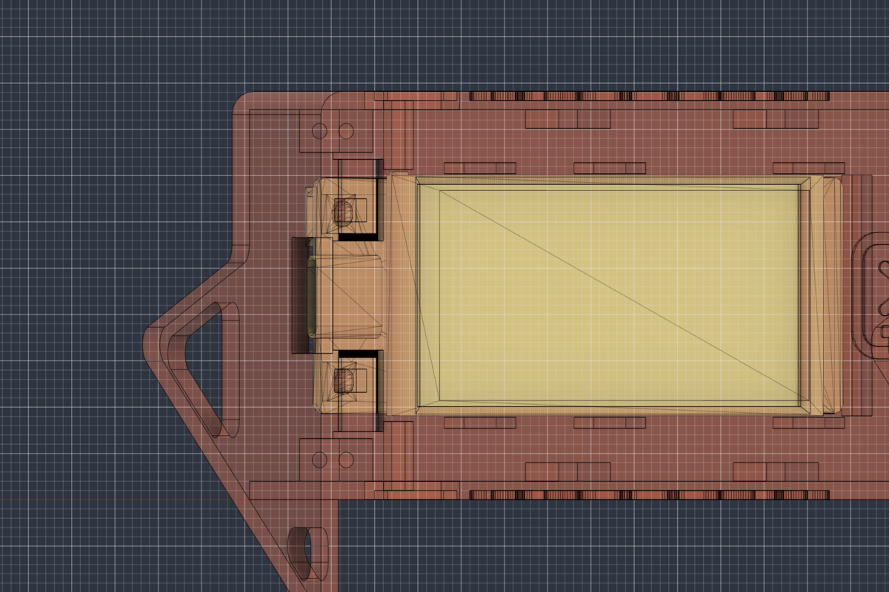</p>

Готовые к нарезке STL (в миллиметрах, все детали проверены на замкнутость):

| Файл | Деталь | Как класть на стол | Размер, мм |
|---|---|---|---|
| [`asb-lcd-shell.stl`](hardware/case/lcd/asb-lcd-shell.stl) | Корпус со щёками, окном, толкателями, логотипом и прорезями | лицом (экраном) вниз | 94,2 × 59,6 × 56,2 |
| [`asb-lcd-divider.stl`](hardware/case/lcd/asb-lcd-divider.stl) | Перегородка: площадки-прижимы платы, планка за выключателем, гнездо аккумулятора, отверстия под провода, стойки под крышку | гнездом вверх, с поддержками под пластиной | 89,7 × 39,6 × 24,7 |
| [`asb-lcd-lid.stl`](hardware/case/lcd/asb-lcd-lid.stl) | Задняя крышка с гравировкой | гравировкой вверх | 89,8 × 39,7 × 2,4 |

PLA или PETG, слой 0,2 мм. Корпусу и крышке поддержки не нужны; у перегородки снизу площадки и планка — печатайте её с поддержками (древовидные проще всего снять).

Ещё понадобятся: восемь саморезов **M2×8** (полукруглая головка до Ø4 мм), аккумулятор 103565 с двухконтактным разъёмом 1,25 мм (гнездо — до 68 × 36 × 10,5 мм вместе с платой защиты), по желанию — выключатель питания с фиксацией **PBS-101G1** (типа 1712, 17 × 12 мм).

Сборка:
1. Выключатель (если ставите) — в карман в верхнем углу напротив USB: кнопка в отверстие, лепестки — в прорези упоров.
2. Плата стеклом к окну, USB-C — в проём на торце, кнопка RST на боковом торце — к верхней стенке. Боковые рёбра и упор с торца держат её с зазором 0,15 мм.
3. Сверху перегородка — её планка опускается за выключатель и держит его при нажатии; — четыре площадки давят на край платы там, где на обороте нет деталей, и плата не ходит вперёд-назад. **Четыре винта** по углам проходят перегородку и вкручиваются в колонны корпуса.
4. Аккумулятор — в гнездо платой защиты и проводами **к торцу с USB**: этот торец гнезда открыт, а провод уходит вниз в отверстие прямо над разъёмом аккумулятора на плате.
5. Крышка заподлицо — **четыре винта** в стойки перегородки. Чтобы сменить аккумулятор, снимается только крышка: плата остаётся прижатой.

Кнопки нажимаются через корпус. **BOOT и KEY** стоят на лице платы у USB-C, по обе стороны от разъёма; верхнюю нажимает гибкий язычок в лицевой панели. **RST** — на боковом торце платы, её язычок — в верхней стенке: ставьте плату кнопкой RST вверх. Выключатель питания с фиксацией **PBS-101G1** («фонариковый» 1712, корпус 17 × 12 × 6,5 мм) стоит в кармане в верхней стенке у торца напротив USB: отверстие Ø6,5 мм под кнопку с выточкой изнутри под ободок, с торцов — упоры с прорезями под лепестки, по бокам — лицевая панель и перегородка, сзади — планка, опущенная с перегородки. Чтобы он поместился, отсек перед перегородкой сделан глубиной 12,6 мм — корпус стал толще на 2,6 мм. Размеры — `pwr_*` в `geometry.py`. В перегородке у торца напротив USB — U-паз шириной 6 мм под провод (открыт к краю, провод заводится сбоку) с вырезом в стенке гнезда над ним: провод от кнопки питания проходит в отсек аккумулятора. Окно дисплея длиной 44,5 мм, место — по примерке на плате. У торца с USB между гнездом и стенкой — полка 11 мм с отверстием 10 × 12 мм: провод аккумулятора с разъёмом аккуратно уходит вниз к плате.

Как менять корпус: размеры — в `geometry.py`; `python hardware/case/lcd/make.py` проверит посадку платы, аккумулятора, кнопок и головок винтов и пересоберёт скрипт для Fusion 360 (`fusion/AgentStatusBarCase`: Utilities → Scripts and Add-Ins → «+» → Run) — он строит модель со всей историей и сохраняет STL рядом с собой. Посадка проверена по модели LilyGO, а не на напечатанной детали: если у вашей ревизии платы что-то иначе, поправьте `btn_*`, `rst_*` и `usb_from_glass`.

**T-Display-S3 AMOLED** — ниже.


В [`hardware/case/amoled/`](hardware/case/amoled/) — корпус из трёх деталей для 3D-печати: лоток с местом под небольшой Li-ion аккумулятор под платой и вырезами для USB-C и боковых кнопок, рамка экрана на защёлке и подставка с наклоном 22°. STL готовы к слайсеру (PLA, слой 0,2 мм, без поддержек; рамку печатать лицом вниз). В сборе — около 65 × 30 × 19 мм.

<p align="center">
  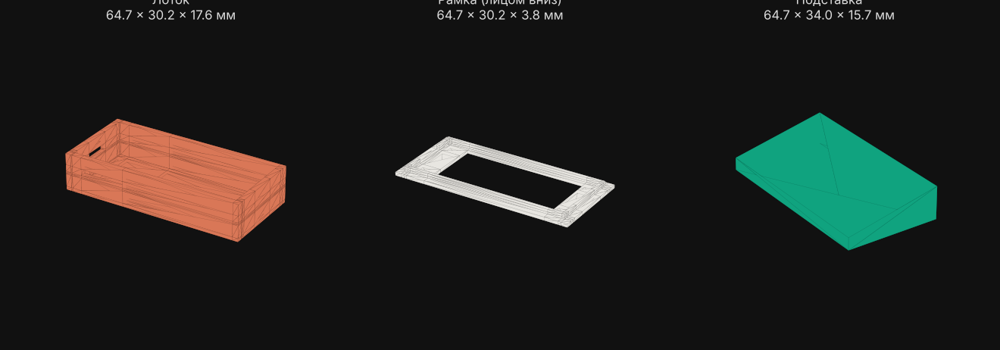
</p>

Размеры взяты из характеристик платы (60 × 25,5 × 10 мм), а не с чертежа — измерьте свою плату и поправьте `PARAMS` в `hardware/case/amoled/case.py` (или переменные в `case.scad` для OpenSCAD), затем `python hardware/case/amoled/case.py` (нужны `numpy` и `matplotlib`) пересоберёт STL. Официальная модель корпуса от LilyGO есть в [репозитории платы](https://github.com/Xinyuan-LilyGO/T-Display-S3-AMOLED) (`shell/`).

## Установка с нуля по шагам

Для тех, кто ни разу не прошивал плату. Всё на Windows, ESP-IDF ставить не нужно: в проекте лежит готовая прошивка для LCD-платы. На macOS и Linux команды те же, только вместо `py -3` пишите `python3`, а вместо `\` в путях — `/`.

**Понадобится:** плата, USB-C кабель **с передачей данных** (кабели «только для зарядки» плату не покажут), компьютер с интернетом и [Claude Code](https://claude.com/claude-code) или Codex.

### Самый простой путь — страница настройки

**[yakory777.github.io/Status-Bar](https://yakory777.github.io/Status-Bar/)** — прошивка и Wi-Fi прямо из Chrome или Edge, без консоли, Python и ESP-IDF. Подключите плату кабелем, выберите её на странице, нажмите **«Прошить плату»**, затем **«Подключиться к плате»** и добавьте сеть. Страница покажет версию прошивки на плате и предложит обновление, когда выйдет новая. Шаги 2–6 и 9 ниже — то же самое через командную строку.

<p align="center">
  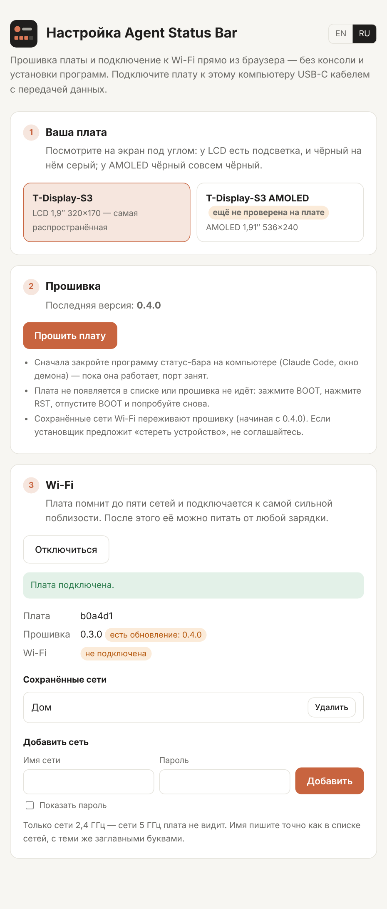
</p>

### Шаг 1. Узнайте свою плату

Посмотрите на экран при включении со стоковой прошивкой или поднесите к свету: у LCD-платы (**T-Display-S3**) видна подсветка — чёрный цвет на ней серый. У AMOLED (**T-Display-S3 AMOLED**) чёрный совсем чёрный, а надпись на плате или коробке обычно говорит *AMOLED*. Готовые прошивки есть для обеих; для AMOLED она собрана, но на живой плате ещё не проверялась.

### Шаг 2. Поставьте Python

Скачайте Python 3.10 или новее с [python.org](https://www.python.org/downloads/) и установите. Проверьте в командной строке (`Win+R` → `cmd` → Enter):

```
py -3 --version
```

Должно ответить `Python 3.x.x`. Если вместо этого открывается Microsoft Store, Python не установлен — поставьте его с python.org.

### Шаг 3. Скачайте проект

На странице репозитория нажмите зелёную кнопку **Code → Download ZIP** и распакуйте архив, например, на рабочий стол. Или, если есть git: `git clone https://github.com/yakory777/Status-Bar`.

Откройте командную строку **сразу в папке проекта**: зайдите в неё в Проводнике (там, где лежат `README.md`, `host`, `firmware`), щёлкните по адресной строке сверху, напишите `cmd` и нажмите Enter. Все команды ниже вводятся в этом окне.

### Шаг 4. Поставьте программы для Python

```
py -3 -m pip install pyserial esptool
```

`pyserial` нужен, чтобы говорить с платой по кабелю, `esptool` — чтобы её прошить.

### Шаг 5. Найдите COM-порт платы

Подключите плату кабелем. Откройте *Диспетчер устройств* (правый клик по «Пуску») → **Порты (COM и LPT)**. Там появится «Устройство с последовательным интерфейсом USB (**COM3**)» — номер может быть другим, запомните его.

Видите только COM1 или ничего нового? Кабель без данных, или плата не отвечает: зажмите на плате кнопку **BOOT**, коротко нажмите **RST**, отпустите BOOT — порт должен появиться.

### Шаг 6. Прошейте

Подставьте свой номер порта вместо `COM3`:

```
py -3 -m esptool --chip esp32s3 -p COM3 -b 460800 write_flash 0x0 firmware\prebuilt\agent-status-bar-tdisplay-s3.bin
```

Прошивка занимает около минуты и заканчивается строкой `Hash of data verified`. Если пишет `Failed to connect` — зажмите BOOT, нажмите RST, отпустите BOOT и повторите команду.

После прошивки нажмите RST или выньте и вставьте кабель. На экране появится заставка — она ждёт Wi-Fi до 15 секунд (без сохранённых сетей — 6 секунд; кнопка — пропустить), — а потом сцена ожидания с надписью **«Нет связи с компьютером»** сверху — так и должно быть: программа на компьютере ещё не запущена.

### Шаг 7. Проверьте без агента

```
py -3 host\daemon.py --demo
```

Через пару секунд надпись пропадёт, и на экране пойдёт пример задачи. Остановить — `Ctrl+C`. Если пишет, что порт занят, — закройте всё, что может держать COM-порт (монитор ESP-IDF, Arduino IDE, второе окно с демоном).

### Шаг 8. Подключите к Claude Code

Статусы передают хуки, а они есть в **Claude Code** — в терминале и во вкладке Code приложения Claude — и в Codex. Пишете в обычном чате claude.ai в браузере — поставьте [расширение](#чат-claudeai-в-браузере).

В Claude Code введите **по одной команде за раз** (две команды в одном поле не сработают):

```
/plugin marketplace add yakory777/Status-Bar
```

```
/plugin install agent-status-bar@agent-status-bar
```

Перезапустите Claude Code и дайте ему любую задачу — экран переключится на неё. Демон запускать вручную не нужно: первое же событие агента поднимет его само.

Для Codex — `codex plugin marketplace add yakory777/Status-Bar`, затем включите **Agent Status Bar** в списке плагинов и разрешите его хуки.

### Шаг 9 (по желанию). Без кабеля, по Wi-Fi

Плата подключена кабелем, команды — из папки проекта:

```
py -3 host\daemon.py wifi add "ИмяСети" "пароль"
```

Имя сети — точно как в списке Wi-Fi, с теми же заглавными буквами; сеть должна быть **2,4 ГГц** (сети 5 ГГц плата не видит). Плата перезагрузится; через 15 секунд проверьте:

```
py -3 host\daemon.py wifi list
```

Там будет IP платы, а значок Wi-Fi на экране перестанет быть перечёркнутым. Впишите IP в настройки, чтобы демон находил плату без поиска:

```
py -3 host\daemon.py config --init
notepad %USERPROFILE%\.agent-status\config.toml
```

В последней строке: `wifi_host = "192.168.1.50"` (ваш IP). Сохраните. Теперь плату можно питать от любой зарядки — демон найдёт её в сети и вернётся на кабель, когда вы его подключите. Сопряжение для этого компьютера не нужно: он уже знаком плате по кабелю. Подробнее — в разделе [Wi-Fi](#wi-fi).

## Установка

Коротко — для тех, кто знаком с ESP-IDF. Впервые? Идите по [шагам выше](#установка-с-нуля-по-шагам).

### 1. Прошивка

Готовые прошивки лежат в [`firmware/prebuilt/`](firmware/prebuilt/) (`…-tdisplay-s3.bin` — LCD, `…-amoled.bin` — AMOLED) — ESP-IDF для них не нужен. Проще всего — [страница настройки](https://yakory777.github.io/Status-Bar/), или так:

```bash
python -m esptool --chip esp32s3 -p COM3 -b 460800 write_flash 0x0 firmware/prebuilt/agent-status-bar-tdisplay-s3.bin
```

Собрать самому:

Нужен [ESP-IDF](https://docs.espressif.com/projects/esp-idf/) 5.1 или новее (на Windows команды вводятся в окне *ESP-IDF CMD*, ярлык появляется после установки). LVGL 9.2 скачается автоматически через менеджер компонентов.

```bash
cd firmware
idf.py set-target esp32s3
idf.py menuconfig          # Agent Status Bar → Board: T-Display-S3 (LCD, по умолчанию) или T-Display-S3 AMOLED
idf.py build flash monitor # monitor показывает лог платы; выход — Ctrl+]
```

Если плата не прошивается, зажмите BOOT, нажмите RST и отпустите BOOT. После прошивки выньте и вставьте кабель.

Чёрный экран? Включите в том же меню *Flash red, green and blue at boot*: тогда панель проверяется до запуска интерфейса, и если цветов нет — выбрана не та плата. Картинка вверх ногами — включите *Rotate the picture 180 degrees*. `idf.py monitor` раз в 5 с пишет частоту кадров (`perf: … fps`).

### 2. Зависимость Python

```bash
pip install pyserial          # на Windows: py -3 -m pip install pyserial
```

### 3. Плагин

**Claude Code**

```
/plugin marketplace add yakory777/Status-Bar
/plugin install agent-status-bar@agent-status-bar
```

**Codex**

```bash
codex plugin marketplace add yakory777/Status-Bar
```

Затем установите **Agent Status Bar** из списка плагинов. Codex не доверяет хукам плагинов автоматически: просмотрите и включите их, когда Codex попросит.

Всё. Первое же событие агента запустит демон, а он найдёт плату по USB VID Espressif (или возьмёт `serial_port` из [файла настроек](#файл-настроек)).

Хуки пробуют `python3`, потом `python`, потом лаунчер `py -3`, поэтому обычная установка Python на Windows подходит как есть. На Windows ставьте pyserial в тот же Python: `py -3 -m pip install pyserial`. Если `python` открывает Microsoft Store, выключите псевдонимы *python.exe* и *python3.exe* в Параметрах («Псевдонимы выполнения приложений»).

## Wi-Fi

Из коробки плата работает по USB-кабелю. Чтобы поставить её куда угодно на столе только с зарядкой, научите её своим сетям — она помнит до пяти и подключается к самой сильной из тех, что рядом.

**1. Добавьте сети** (плата подключена кабелем, команды — из папки проекта):

```bash
python host/daemon.py wifi add "Дом" "пароль"
python host/daemon.py wifi add "Офис" "пароль"
python host/daemon.py wifi list            # сохранённые сети, текущая, IP и сигнал
python host/daemon.py wifi remove "Офис"
```

Сети хранятся в памяти платы и переживают перезагрузку и перепрошивку. Плата видит только сети **2,4 ГГц**; имя пишите точно как в списке сетей, с тем же регистром. После каждого изменения плата перезагружается и через несколько секунд подключается; значок Wi-Fi в углу показывает сигнал. Заодно плата начинает доверять этому компьютеру, так что сопряжение для него не нужно.

**2. Отключите кабель с данными.** Питайте плату от зарядки или аккумулятора. Демон сам найдёт её в сети (компьютер должен быть в той же сети) и вернётся на кабель, как только вы снова его подключите. После перезагрузки платы, роутера или компьютера связь восстанавливается сама: демон помнит последний IP платы, а если роутер выдал ей новый — перебирает адреса своей сети. Пропажу платы он замечает примерно за 25 секунд и сразу начинает искать её заново.

**Другой компьютер**, который ни разу не подключал плату по USB, проходит сопряжение по сети:

```bash
python host/daemon.py pair
```

Компьютеру, который плата уже знает, код не показывается — `pair` сразу ответит, что сопряжение есть. Новому компьютеру в консоли и на плате появится шестизначный код. Код тот же — нажмите кнопку на плате, удержание — отмена. После этого плата принимает статусы только от доверенных компьютеров, и агент коллеги в офисной сети не окажется на вашем экране.

`python host/daemon.py boards` покажет платы в сети. Если плата подключена, но не находится (широковещательный запрос ушёл в VPN или WSL, его режет роутер или брандмауэр), укажите её IP из `wifi list`: `python host/daemon.py pair --ip 192.168.1.50` — и впишите его в `wifi_host` в [файле настроек](#файл-настроек), чтобы демон всегда шёл к ней напрямую. Там же `transport = "usb"` или `"wifi"` закрепляет один способ связи.

<p align="center">
  
</p>

## Чат claude.ai в браузере

В обычном чате claude.ai нет хуков, поэтому статусы с него передаёт расширение для Chrome из папки [`browser/`](browser/). Оно подходит и для других браузеров на Chromium: Edge, Яндекс Браузер, Opera. Firefox и Safari не поддерживаются, вкладка Chat в приложении Claude для компьютера тоже: туда расширения не ставятся.

Расширение следит за страницей и показывает на плате тему Claude:

| На странице | На плате |
|---|---|
| Вы отправили вопрос | «Думает…», заголовок — ваш вопрос |
| Claude пишет ответ | «Пишет ответ», заголовок — название чата |
| Окно «Разрешить» для инструмента | Ждёт вас; удержать кнопку — «Разрешить один раз», нажать — «Отклонить» |
| Ответ готов | Готово · «Ответ готов» |
| Вкладку закрыли | Сцена ожидания |

Каждая вкладка — отдельная сессия, так что чат и Claude Code уживаются на одном экране: главная задача видна, остальные — бейджем «+N». Плана в чате нет, поэтому полоска прогресса просто заполняется, когда ответ готов.

**Установка**

1. Откройте `chrome://extensions`, включите **Режим разработчика** (переключатель справа вверху), нажмите **Загрузить распакованное расширение** и выберите папку `browser` из проекта.
2. Обновите открытые вкладки claude.ai (F5).
3. Запустите демон. В чате нет хуков, которые подняли бы его сами, поэтому на Windows включите автозапуск: дважды щёлкните `tools\windows\autostart.cmd`. Демон запустится сразу и дальше будет стартовать при входе в Windows без окна. Выключить — `tools\windows\autostart.cmd remove`. Вручную — `py -3 host\daemon.py`; на macOS и Linux — `python3 host/daemon.py`.
4. Нажмите на значок расширения. Окошко покажет, работает ли программа на компьютере, как подключена плата, что видно на странице и какие признаки сработали. Там же расширение можно выключить, а кнопка **«Прошивка и Wi-Fi платы»** открывает [страницу настройки](https://yakory777.github.io/Status-Bar/).

<p align="center">
  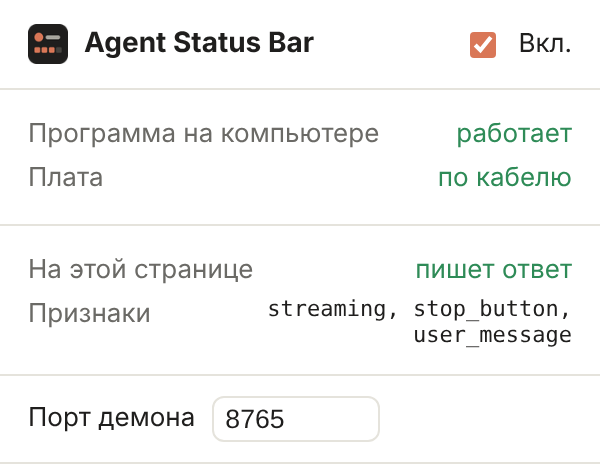
</p>

**Если статус перестал определяться.** claude.ai время от времени меняет вёрстку. Всё, что расширение знает о странице, собрано в [`browser/detect.js`](browser/detect.js). Пока Claude пишет ответ, в окошке расширения в строке «Признаки» должно быть `streaming` или `stop_button`. Если там пусто, признаки устарели: откройте issue, а после правки `detect.js` нажмите ⟳ у расширения на `chrome://extensions`.

## Если что-то не работает

Всё, на что мы уже наступали, — с причинами и решениями.

**Прошивка**

| Что видно | Почему | Что делать |
|---|---|---|
| `"esptool.py" не является внутренней или внешней командой` | В новых версиях команда называется без `.py` | `esptool …` в окне ESP-IDF или `py -3 -m esptool …` в обычном |
| `Системе не удается найти указанный путь`, `CMakeLists.txt not found` | Команда запущена не из той папки | `idf.py` — только из папки `firmware`, `py -3 host\daemon.py` — из корня проекта. Путь с пробелами берите в кавычки |
| В Диспетчере устройств только COM1, `Failed to connect` | Кабель без данных или плата не в режиме прошивки | Другой кабель или порт USB; зажать BOOT, нажать RST, отпустить BOOT |
| `could not open port 'COM3'`, `Access is denied`, порт занят | Порт держит другая программа — чаще всего запущенный демон или `idf.py monitor` | Закрыть Claude Code и монитор. Если не помогло, в PowerShell: `Get-CimInstance Win32_Process -Filter "Name like 'py%'" \| ? CommandLine -like '*daemon.py*' \| % { Stop-Process -Id $_.ProcessId }` |
| После прошивки экран чёрный, мигает или только светится подсветка | Прошивка для другой платы (AMOLED-прошивка на LCD-плате или наоборот) | Для LCD — `firmware\prebuilt\agent-status-bar-tdisplay-s3.bin` или *Board: T-Display-S3* в menuconfig; для AMOLED — *T-Display-S3 AMOLED*. Проверка панели — *Flash red, green and blue at boot* |
| Картинка вверх ногами | Плата стоит перевёрнутой | menuconfig → *Rotate the picture 180 degrees* |
| После прошивки `wifi list` пишет `Saved networks: none` | Прошивки до 0.4.0 хранили сети там, куда пишет готовый образ; страница настройки до 1.0.0 стирала плату целиком без вопроса | Прошить текущую и один раз добавить сети заново. На странице настройки установщик спрашивает «Erase device» — галочку не ставить, тогда сети останутся |
| Анимация медленная, дёргается | Старая прошивка | Прошить текущую. `idf.py -p COM3 monitor` раз в 5 с пишет `perf: … fps` — пришлите эту строку в issue |

**Компьютер и Claude Code**

| Что видно | Почему | Что делать |
|---|---|---|
| `python` открывает Microsoft Store, хуки не срабатывают | В Windows `python` и `python3` — заглушки магазина | Поставить Python с python.org; пользоваться `py -3`. Хуки сами пробуют `py -3`. Можно выключить псевдонимы *python.exe* и *python3.exe*: Параметры → «Псевдонимы выполнения приложений» |
| `No module named serial` | pyserial стоит в другом Python | `py -3 -m pip install pyserial` |
| `Path does not exist: …\Status-Bar \plugin install …` | Две команды `/plugin` вставлены в одно поле | Вводить по одной |
| На плате «Нет связи с компьютером» | Демон не запущен (Claude Code закрыт или ещё не было событий) | Дать агенту задачу или запустить `py -3 host\daemon.py` |
| Статусы из чата claude.ai не приходят | В браузерном чате нет хуков | Поставить [расширение](#чат-claudeai-в-браузере) и запустить демон (`tools\windows\autostart.cmd`). В окошке расширения видно, что не так |

**Wi-Fi**

| Что видно | Почему | Что делать |
|---|---|---|
| `wifi list` → `Saved networks: none` | Сети ещё не добавлены | `py -3 host\daemon.py wifi add "ИмяСети" "пароль"` |
| Сеть сохранена, но не подключается | Сеть 5 ГГц, опечатка в имени или пароле | Выбрать сеть 2,4 ГГц (без *5G* в названии); имя — с тем же регистром; `wifi remove` и добавить заново |
| `No board found on the network` | Широковещательный поиск ушёл не в тот адаптер (VPN, WSL, Hyper-V), его режет роутер или брандмауэр | Указать IP из `wifi list`: `py -3 host\daemon.py pair --ip 192.168.1.50` и вписать его в `wifi_host`. Когда Windows спросит про доступ Python к сети — разрешить |
| После перезагрузки платы или роутера связь по Wi-Fi не возвращается | Старая версия демона: плата получила новый IP, а демон стучался по старому | Обновить проект — новый демон находит плату и с новым IP. Если значок Wi-Fi на плате перечёркнут, значит, не подключилась сама плата: проверьте `wifi list` по кабелю |
| Код сопряжения на плате не появляется | Компьютер уже подключался кабелем, и плата ему доверяет — сопряжение не нужно | Ничего: `pair` так и ответит. Код понадобится только другому компьютеру |
| Сопряжение обрывается само | Демон в фоне переподключается к плате и вытесняет сопряжение (плата держит одно сетевое соединение) | Сначала закрыть Claude Code и демон, потом `pair` |

Проверить сопряжение на том же компьютере можно, представившись плате новым компьютером — в отдельном окне `cmd` с остановленным демоном:

```
set AGENT_STATUS_HOME=%TEMP%\asb-test
py -3 host\daemon.py pair --ip 192.168.1.50
```

`set` действует только в этом окне; закройте его после проверки — ваши настройки не изменятся.

Не нашли своего случая — откройте issue с текстом ошибки, выводом `wifi list` и последними строками `idf.py -p COM3 monitor`.

## Попробовать без платы

### Симулятор прошивки

`tools/sim/` собирает код интерфейса прошивки (`firmware/main/ui_*.c`, `protocol.c`) вместе с LVGL 9.2 прямо на компьютере, проигрывает сценарий и сохраняет гифку. Ни платы, ни ESP-IDF не нужно:

```bash
pip install pillow                     # плюс cmake и компилятор C
python tools/sim/render.py tools/sim/scenarios/error.txt error.gif
python tools/sim/render.py tools/sim/scenarios/wait_escalation.txt wait.gif --clip 57-68
```

Сценарий — текстовый файл из строк `<время_мс> <JSON>`, ровно то, что демон шлёт плате. CI прогоняет все сценарии из `tools/sim/scenarios/`, так что правка, ломающая код экрана, не пройдёт сборку.

### Эмулятор в браузере

Откройте [`docs/emulator.html`](docs/emulator.html) в браузере для быстрого интерактивного просмотра: кнопки изображают события хуков. Это старая копия экрана задачи на JavaScript, в ней нет новых экранов (сцен ожидания, индикаторов, кнопки, языков); точную картинку даёт симулятор выше.

Демон можно запустить в демо-режиме или проверить через curl:

```bash
python host/daemon.py --demo
curl -X POST "http://127.0.0.1:8765/?agent=claude" -d '{"hook_event_name":"UserPromptSubmit","prompt":"Тест"}'
curl -X POST "http://127.0.0.1:8765/?agent=claude" -d '{"hook_event_name":"Stop"}'
curl http://127.0.0.1:8765/   # текущее состояние
```

## Протокол

Демон шлёт на плату по одной строке JSON на обновление:

```json
{"state":"work","title":"Отрефактори модуль авторизации","step":"Пишу тесты","done":3,"total":5,"sub":2,"others":1,"agent":"claude","idle":"robot","lang":"ru"}
{"ping":1}
```

| Поле | Значение |
|---|---|
| `state` | `idle`, `start`, `work`, `wait`, `done`, `error`, `compact` |
| `title`, `step` | Запрос и текущий шаг; не передали — остаётся прежний текст |
| `done`, `total` | Прогресс по плану, `total` ограничен 1–12 |
| `sub` | Работающие субагенты (бейдж скрыт при 0) |
| `others` | Другие активные сессии (бейдж скрыт при 0) |
| `agent` | Тема: `claude` или `codex` |
| `idle` | Сцена ожидания для темы |
| `ping` | Признак жизни, каждые 5 с; 15 с тишины — «Нет связи» |
| `pair` | Шестизначный код на экране сопряжения; `""` скрывает его. По Wi-Fi приходит вместе с `pair_token` — `hello`, `pair`, `wifi_add`/`wifi_remove`/`wifi_list` описаны в [`net_esp.h`](firmware/main/net_esp.h) |
| `approve` | `true` — плата предлагает «удержать — разрешить / нажать — отклонить» для текущего ожидания |
| `lang` | `en` или `ru` — язык подписей самой платы |

Обратно плата присылает строки на нажатия: `{"button":"approve"}`, `{"button":"deny"}`, `{"button":"scene_next","scene":"cursor"}`.

Все поля необязательны, плата помнит последнее значение. Управлять дисплеем может всё, что умеет писать в последовательный порт, не только агенты.

### Какие события слушает демон

| На экране | Claude Code | Codex | Чат claude.ai (расширение) |
|---|---|---|---|
| Старт | `UserPromptSubmit` | `UserPromptSubmit` | `WebPrompt` |
| Работа, текущий шаг | `PreToolUse`, `PostToolUse` | `PreToolUse`, `PostToolUse` | `WebBusy` (думает / пишет) |
| Прогресс по плану | события `TaskCreated`, `TaskCompleted`; инструменты `TaskCreate`, `TaskUpdate`, старый `TodoWrite` | инструмент `update_plan` | — |
| Ждёт вас | `PermissionRequest`, `Notification` (запрос разрешения или ввода) | `PermissionRequest` | `WebWait` |
| Ошибка | `PostToolUseFailure`, `StopFailure` | ненулевой код выхода в `PostToolUse` | `WebError` |
| Субагенты | `SubagentStart`, `SubagentStop` | `SubagentStart`, `SubagentStop` | — |
| Сжатие | `PreCompact`, `PostCompact` | `PreCompact`, `PostCompact` | — |
| Готово | `Stop` | `Stop` | `WebDone` |
| Сессия закрыта | `SessionEnd` | — | `SessionEnd` (вкладку закрыли) |

## Как добавить другого агента

Создайте `host/adapters/<имя>.py` со строкой `NAME` и функцией `handle(event, state, ctx)`, которая обновляет `state` и возвращает `True`, если экран нужно перерисовать. Зарегистрируйте модуль в `host/adapters/__init__.py` и направьте хуки агента на `hooks/forward.py <имя>`.

## Настройка

### Файл настроек

Демон и хуки читают `~/.agent-status/config.toml`. Создать его с комментариями и посмотреть, что действует сейчас:

```bash
python host/daemon.py config --init   # создаст ~/.agent-status/config.toml
python host/daemon.py config          # итоговые настройки и откуда каждая взялась
python host/daemon.py config set button_approve true   # поменять одну настройку в файле
```

```toml
language = "auto"        # язык экрана: "en", "ru" или "auto" (по системной локали)
serial_port = ""         # пусто — искать плату по USB; или "COM5", "/dev/cu.usbmodem1101"
http_port = 8765
autostart = true         # хук сам запускает демон, если тот не запущен
idle_claude = "robot"    # robot | cursor
idle_codex = "cursor"    # cursor | typist
button_approve = true    # отвечать на запросы разрешения Claude Code кнопкой
approve_wait = 60        # сколько секунд хук ждёт кнопку (1–120)
transport = "auto"       # auto (кабель, без него Wi-Fi) | usb | wifi
wifi_host = ""           # IP платы, только если она не находится в сети сама
```

У каждого ключа есть переменная окружения, она важнее файла: `AGENT_STATUS_LANG`, `AGENT_STATUS_SERIAL`, `AGENT_STATUS_PORT`, `AGENT_STATUS_AUTOSTART`, `AGENT_STATUS_IDLE_CLAUDE`, `AGENT_STATUS_IDLE_CODEX`, `AGENT_STATUS_BUTTON_APPROVE`, `AGENT_STATUS_APPROVE_WAIT`, `AGENT_STATUS_TRANSPORT`, `AGENT_STATUS_WIFI_HOST`. Папку можно перенести переменной `AGENT_STATUS_HOME`, сам файл — `AGENT_STATUS_CONFIG`.

Сцена, выбранная двойным нажатием на плате, сохраняется рядом в `state.json` и переживает перезапуск.

**Язык.** Демон шлёт `"lang"` в каждом обновлении, поэтому подписи самой платы («В работе», «Ждёт вас») и тексты, которые пишет демон («Правит auth.ts», «Разрешить запись README.md?»), переключаются вместе. До первого сообщения плата берёт язык из `idf.py menuconfig → Agent Status Bar → Screen language`. Переводы лежат в `host/i18n.py` и `firmware/main/ui_i18n.c`; новый язык — ещё одна колонка в каждом.

### Константы прошивки

| Что | Где |
|---|---|
| Цвета состояний по темам | `THEMES` в `firmware/main/ui_status.c` |
| Подписи на экране | `TEXT` в `firmware/main/ui_i18n.c` |
| Когда ожидание начинает напоминать | `UI_WAIT_ESCALATE_MS` в `firmware/main/ui_status.h` (60 с) |
| Через сколько тишины «Нет связи» | `PROTO_LINK_TIMEOUT_MS` в `firmware/main/protocol.h` (15 с) |
| Сколько висит «Готово» до сцены ожидания | `UI_DONE_TO_IDLE_MS` в `firmware/main/ui_screen.h` (90 с) |
| Маскот засыпает, экран тускнеет | `UI_SLEEP_AFTER_MS`, `UI_BRIGHT_SLEEP` там же (10 мин) |
| Экран гаснет | `UI_OFF_AFTER_MS` там же (30 мин) |
| Пин батареи и пороги | `BAT_ADC_CHANNEL`, `BAT_NO_BATTERY_MV`, `BAT_USB_MV` в `firmware/main/platform_esp.c` |
| Обычная яркость | `UI_BRIGHT_ON` в `firmware/main/ui_screen.h` |
| Картинка вверх ногами | `idf.py menuconfig → Agent Status Bar → Rotate the picture 180 degrees`; зеркальная на AMOLED — `LCD_MADCTL` в `firmware/main/display_rm67162.c` |
| Полосы или артефакты | AMOLED: `LCD_FREQ` в `firmware/main/display_rm67162.c` (40 МГц; 75 МГц быстрее, если стабильно). LCD: `PCLK_HZ` в `firmware/main/display_st7789.c` (10 МГц) |
| Шрифт | замените TTF в `firmware/main/fonts/` (имена те же) |
| Пины кнопки, второй кнопки, пищалки, язык по умолчанию | `idf.py menuconfig → Agent Status Bar` |
| Время долгого и двойного нажатия | `UI_LONG_PRESS_MS`, `UI_DOUBLE_CLICK_MS` в `firmware/main/ui_input.h` |

## Как перерисовать превью

Гифки прошивки (всё в `docs/firmware/`, обе темы и оба языка) делает симулятор; если установлен `ffmpeg`, гифки выходят примерно вдвое легче:

```bash
pip install pillow                                # плюс cmake и компилятор C
python tools/sim/render_docs.py                   # все, ~1 мин
python tools/sim/render_docs.py --lang ru         # один язык
python tools/sim/render_docs.py task button       # только эти
```

Исходные превью дизайна на Python (в `docs/` хранятся только первые два):

```bash
python tools/render_task.py --theme claude        # docs/claude_task.gif
python tools/render_task.py --theme codex         # docs/codex_task.gif
python tools/render_idle_robot.py                 # docs/claude_idle_robot.gif
python tools/render_idle_cursor.py --theme claude # docs/claude_idle_cursor.gif
python tools/render_idle_cursor.py --theme codex  # docs/codex_idle_cursor.gif
python tools/render_idle_typist.py                # docs/codex_idle_typist.gif
```

Шрифты для скриптов лежат в `tools/fonts/` вместе с лицензиями (Lora — SIL OFL 1.1, DejaVu — лицензия Bitstream Vera).

## Структура

```
.claude-plugin/        манифесты плагина и маркетплейса Claude Code
.codex-plugin/         манифест плагина Codex
.agents/plugins/       манифест маркетплейса Codex
hooks/                 описание хуков и forward.py
browser/               расширение Chrome для чата claude.ai: detect.js (признаки на странице), content.js, background.js, окно
host/                  daemon.py, sessions.py (несколько сессий сразу), links.py (USB и Wi-Fi), config.py (настройки), i18n.py (тексты), адаптеры агентов
firmware/prebuilt/     готовые прошивки для T-Display-S3 (LCD) и AMOLED, прошиваются со страницы настройки или одной командой esptool
docs/flasher/          страница настройки (GitHub Pages): прошивка через ESP Web Tools и Wi-Fi через Web Serial
firmware/main/         проект ESP-IDF, LVGL 9:
  ui_status.c            экран задачи, темы, состояния сценариев
  ui_scene_*.c           сцены ожидания (robot, cursor, typist), ui_scene.c их запускает
  ui_screen.c            заставка, переходы, конфетти, сон, сопряжение
  ui_icons.c             индикаторы батареи, Wi-Fi и звука
  protocol.c             строки JSON от хоста (общий с симулятором)
  ui_input.c, ui_sound.c действия кнопки и мелодии
  ui_i18n.c              подписи экрана на английском и русском
  net_esp.c              Wi-Fi: сохранённые сети, поиск, связь по TCP, доверенные компьютеры, сопряжение
  platform_esp.c         яркость, АЦП батареи, пищалка; input_esp.c — кнопки; display_st7789.c, display_rm67162.c — драйверы панелей (LCD, AMOLED), display_scale.c — уменьшение кадра для LCD
hardware/case/lcd/     корпус LCD + 103565: geometry.py, make.py, скрипт Fusion 360, STL
hardware/case/amoled/  корпус AMOLED: case.py (генератор), case.scad, STL, превью
docs/firmware/         гифки прошивки: en/ и ru/, в каждой claude/ и codex/; эмулятор в браузере в docs/
tools/                 скрипты превью дизайна
tools/windows/         autostart.cmd — автозапуск демона при входе в Windows (для расширения)
tools/sim/             симулятор прошивки: настоящий код экрана + LVGL на ПК, сценарии, экспорт в GIF
```

## Статус

Демон, адаптеры, учёт сессий, выбор сцены ожидания, настройки, оба языка и связь по Wi-Fi (на имитации платы) покрыты тестами. Все экраны, сцены и анимации прогоняются в симуляторе прошивки и в CI.

На настоящей плате **T-Display-S3 (LCD)** проверены: экран, анимации, связь по USB, подключение к Wi-Fi, поиск платы в сети и работа без кабеля. Драйвер **AMOLED** написан по распиновке и протоколу RM67162 из примеров LilyGO и ESPHome, но на реальной плате ещё не запускался — при первой сборке могут понадобиться правки из таблицы [констант прошивки](#константы-прошивки). Расширение для claude.ai проверено на макете страницы с теми же признаками, а на живом claude.ai пока не проверялось — если статус не определяется, см. [что делать](#чат-claudeai-в-браузере). Адаптер Codex рассчитан на формат инструмента `update_plan`; если в вашей версии Codex он другой, поправьте `_plan_steps()` в `host/adapters/codex.py`.

Будем рады issue с текстом ошибки или фото экрана.

## Лицензия

[MIT](LICENSE)
